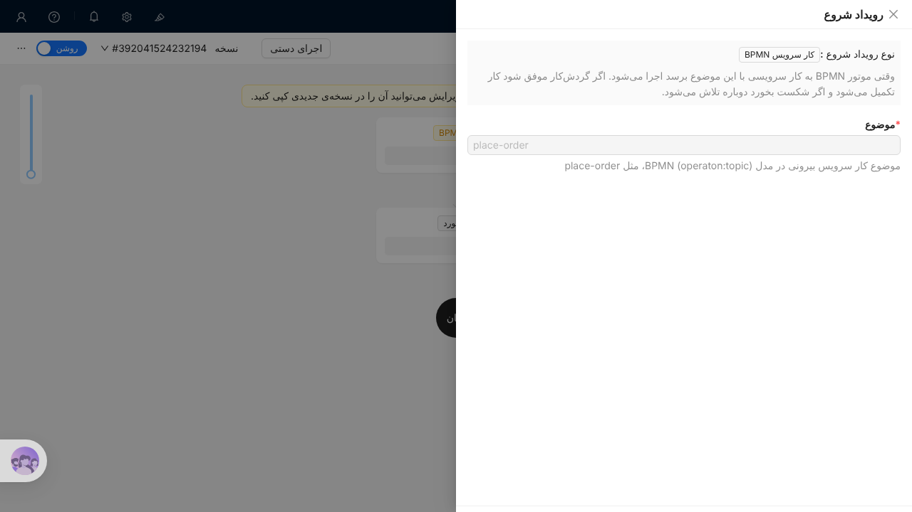

# STORY-081: Worker کارهای سرویس روی مجموعه‌ها

## روایت
به‌عنوان طراح فرایند، می‌خواهم کار سرویس فرایند رکوردی را در NocoBase به‌روز کند، تا نتیجه‌ی فرایند در داده‌ی ERP بنشیند.

## معیار پذیرش
- **Given** کار سرویس با topic ثبت‌شده در پلاگین **When** فرایند به آن برسد **Then** Worker کار را می‌گیرد، گردش‌کار NocoBase وصل به آن topic را با متغیرهای کار اجرا می‌کند و کار را در موتور کامل می‌کند.
- **Given** گردش‌کار شکست بخورد **When** Worker نتیجه را بفرستد **Then** خطا با تعداد تلاش باقی‌مانده به موتور گزارش می‌شود و پس از آخرین تلاش incident ساخته می‌شود.
- **Given** دو نمونه‌ی NocoBase (خوشه) **When** هر دو Worker داشته باشند **Then** هر کار فقط یک بار اجرا می‌شود.

## یادداشت فنی
- گرفتن کار با `fetchAndLock` و long polling؛ قفل با `workerId` هر نمونه‌ی برنامه.
- پیش‌فرض این است که اتصال topic به گردش‌کار با یک رویداد گردش‌کار تازه («کار سرویس BPMN») باشد، تا سازنده‌ی بدون‌کد منطق را با نودهای آشنا بسازد.

## آزمون
- آزمون خودکار: آزمون سرور با کانتینر، شامل شکست و تلاش دوباره.

## پیاده‌سازی
- رویداد گردش‌کار تازه‌ی «کار سرویس BPMN» (`bpm-service-task`) با یک تنظیم: «موضوع». این رویداد همیشه همگام اجرا می‌شود، تا Worker نتیجه را همان لحظه بداند.
- Worker در هر نمونه‌ی برنامه پس از راه‌اندازی شروع می‌شود و هنگام توقف می‌ایستد. هر دو ثانیه (`BPM_WORKER_INTERVAL`) فقط برای موضوع‌هایی که گردش‌کار فعال دارند `fetchAndLock` می‌فرستد. شناسه‌ی هر نمونه `nocobase-<host>-<pid>` است و قفل یک دقیقه طول می‌کشد.
- متغیرهای گردش‌کار: `recordId` و `collection` (از کلید کسب‌وکار `<collection>:<id>`)، `variables` (همه‌ی متغیرهای فرایند) و `task` (شناسه، موضوع، کلید فرایند و کلید کسب‌وکار).
- اگر همه‌ی گردش‌کارهای آن موضوع موفق شوند، کار در موتور کامل می‌شود. اگر یکی شکست بخورد، خطا با یک تلاش کمتر گزارش می‌شود (بار اول ۳ تلاش، فاصله‌ی ۱۰ ثانیه). وقتی تلاشی نماند، موتور incident می‌سازد.
- `BPM_WORKER=off` Worker را در آن نمونه خاموش می‌کند.

### بررسی روی موتور واقعی
- آزمون سرور `OperatonEngine` دو Worker را روی یک کار می‌سنجد: کاری که اولی قفل کرده به دومی داده نمی‌شود و دومی نمی‌تواند آن را کامل کند. شکست با صفر تلاش، incident می‌سازد.
- روی ایمیج آزمایشی با Operaton 2.1.5 کل چرخه اجرا شد: ساخت رکورد «درخواست خرید» فرایند را شروع کرد (STORY-080)، تأیید مدیر در موتور کامل شد، Worker کار «place-order» را گرفت، گردش‌کار «ثبت سفارش» وضعیت رکورد را `ordered` کرد و نمونه‌ی فرایند COMPLETED شد.

## پرسش‌های باز
- خروجی گردش‌کار به موتور برنمی‌گردد و کار بدون متغیر کامل می‌شود. برای نتیجه‌هایی مثل شماره‌ی سفارش، نودی مثل «پاسخ به کار سرویس» لازم است. پیشنهاد: بعد از PoC (STORY-083) و اگر فرایند واقعی خواست.
- Polling کوتاه است و long polling (`asyncResponseTimeout`) نیست، چون long polling اتصال باز را در هر نمونه نگه می‌دارد و توقف برنامه را کند می‌کند. با فاصله‌ی دو ثانیه بار موتور کم است. اگر تأخیر مهم شد، long polling با توقف درست اضافه شود.
- تعداد تلاش و فاصله‌ی آن ثابت است (۳ و ۱۰ ثانیه). اگر لازم شد، در تنظیمات رویداد قابل تغییر شود.
- اگر برای یک موضوع گردش‌کاری فعال نباشد، کار در موتور می‌ماند و incident نمی‌سازد. این عمدی است تا کار پیش از ساخت گردش‌کار گم نشود.

## تعریف انجام‌شده
- [x] کد و آزمون در یک PR
- [x] PR به این استوری لینک دارد
- [ ] بازبینی شد و ادغام شد
