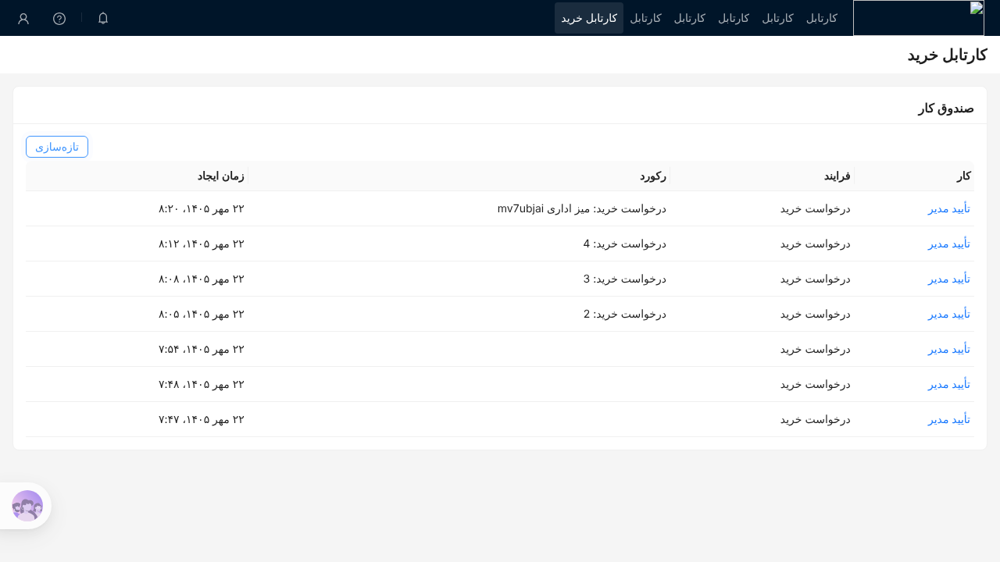
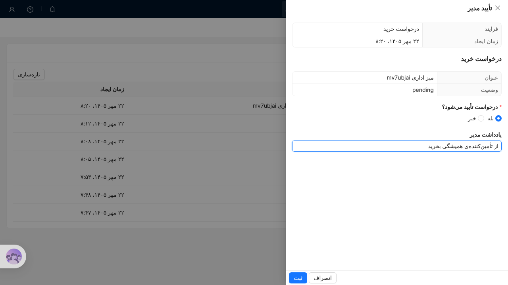

# STORY-082: صندوق کار فارسی

## روایت
به‌عنوان کاربر، می‌خواهم کارهای انسانی فرایند را در NocoBase ببینم و با فرم کامل کنم، تا به رابط انگلیسی موتور نروم.

## معیار پذیرش
- **Given** کار انسانی با candidate group برابر نام نقش **When** کاربر آن نقش «صندوق کار» را باز کند **Then** کار با نام، فرایند، رکورد مرتبط و تاریخ جلالی ساخت دیده می‌شود.
- **Given** همان کار **When** کاربر آن را باز کند **Then** فرم NocoBase وصل به کار با داده‌ی رکورد مرتبط باز می‌شود و «ثبت» کار را با متغیرهای فرم کامل می‌کند.
- **Given** کاربری بدون آن نقش **When** صندوق کار را باز کند یا با API کار را کامل کند **Then** کار را نمی‌بیند و درخواستش ۴۰۳ می‌گیرد.

## یادداشت فنی
- پلاگین کارها را از موتور می‌خواند و دسترسی را خودش با نقش‌های NocoBase می‌سنجد. کاربر مستقیم با موتور حرف نمی‌زند.
- بلوک برای صفحه‌ی مدرن (flow model)، هم‌شکل بلوک‌های داده‌ی NocoBase.

## آزمون
- آزمون خودکار: آزمون سرور دسترسی؛ آزمون e2e باز کردن و کامل کردن کار در فارسی.
- بررسی دستی: تصویر مرجع صندوق کار در RTL.

## پیاده‌سازی
- اکشن‌های `bpmTasks:list`، `bpmTasks:get` و `bpmTasks:complete` برای همه‌ی کاربران واردشده باز است. هر سه کار را با کاربر سرویس از موتور می‌خوانند و فقط کاری را برمی‌گردانند یا می‌پذیرند که یکی از نقش‌های جاری کاربر candidate group آن باشد یا به خود او سپرده شده باشد. کار دیگران ۴۰۳ می‌گیرد و کار بسته‌شده ۴۰۴.
- فرم کار از خود مدل BPMN می‌آید (`operaton:formField`، همان که Camunda Modeler می‌نویسد): نوع‌های متن، عدد صحیح، بولی، تاریخ و فهرست انتخابی، با برچسب فارسی و قید «اجباری». سرور فقط فیلدهای فرم را با نوع درست به موتور می‌فرستد و بقیه‌ی داده‌ی درخواست را دور می‌ریزد.
- رکورد مرتبط از کلید کسب‌وکار `<collection>:<id>` پیدا می‌شود و فیلدهای ساده‌اش در کشوی کار فقط‌خواندنی دیده می‌شوند. فیلدهای پنهان و رمز نشان داده نمی‌شوند. کلیدی که به رکوردی نرسد (مجموعه یا رکورد حذف‌شده، شناسه‌ی نادرست) فقط ستون «رکورد» را خالی می‌گذارد.
- بلوک «صندوق کار» در صفحه‌ی مدرن زیر «بلوک‌های دیگر» می‌آید. تاریخ ساخت در فارسی با تقویم جلالی نوشته می‌شود و در پایگاه داده و موتور UTC می‌ماند.
- مدل نمونه‌ی `purchase-request.bpmn` حالا فرم دارد: «درخواست تأیید می‌شود؟» (اجباری) و «یادداشت مدیر».

### آزمون
- آزمون سرور دسترسی: کارمند بدون نقش کاری نمی‌بیند و `get` و `complete` او ۴۰۳ می‌گیرد؛ فرم اجباری و نوع‌ها سنجیده می‌شود.
- آزمون کلاینت: فهرست، باز کردن کار، فرم اجباری و ثبت؛ تاریخ جلالی (۲۹ اسفند ۱۴۰۴ و ۲ فروردین ۱۴۰۵).
- آزمون e2e [`e2e/bpm/inbox.e2e.ts`](../../../e2e/bpm/inbox.e2e.ts) با Operaton واقعی و دو کاربر، در کار تازه‌ی «E2E (BPMN)» در CI. کار e2e اصلی بدون پلاگین BPMN می‌ماند تا تصویرهای مرجعش عوض نشود.

## پرسش‌های باز
- **فرم کار در مدل BPMN است، نه در طراح فرم NocoBase.** پیشنهاد این بود که فرم NocoBase به کار وصل شود. فرم مدل ساده‌تر است، با Camunda Modeler ساخته می‌شود و فقط تصمیم را به موتور می‌فرستد، که با قاعده‌ی مالکیت داده‌ی تصمیم ۰۰۰۷ می‌خواند. ویرایش خود رکورد در کشوی کار هنوز نیست و کاربر رکورد را در صفحه‌ی خودش ویرایش می‌کند. اگر PoC (STORY-083) نشان داد لازم است، فرم ویرایش رکورد با فیلدهای انتخابی اضافه شود.
- **دیدن کار یعنی دیدن رکوردش.** کشوی کار فیلدهای رکورد را با کاربر سرویس می‌خواند، حتی اگر نقش کاربر روی آن مجموعه دسترسی خواندن نداشته باشد. این در گردش‌های تأیید رایج است، ولی در بازبینی امنیتی STORY-083 دوباره سنجیده می‌شود.
- **نقش جاری، نه همه‌ی نقش‌ها.** کاربری که نقشش را عوض کرده فقط کارهای همان نقش را می‌بیند؛ با «همه‌ی نقش‌ها» (union) همه را. این با رفتار بقیه‌ی NocoBase یکی است.
- **برداشتن کار (claim) نیست.** هر عضو گروه می‌تواند کار را کامل کند. اولی برنده است و دومی پیام «این کار دیگر باز نیست» می‌گیرد.
- **صفحه‌بندی سمت موتور نیست.** فهرست همه‌ی کارهای کاربر را یک‌جا می‌گیرد و برای هر کار سه درخواست به موتور می‌زند (تعریف فرایند cache می‌شود). برای PoC کافی است؛ با کارهای زیاد باید صفحه‌بندی شود.

## تعریف انجام‌شده
- [x] کد و آزمون در یک PR
- [x] PR به این استوری لینک دارد
- [ ] بازبینی شد و ادغام شد
