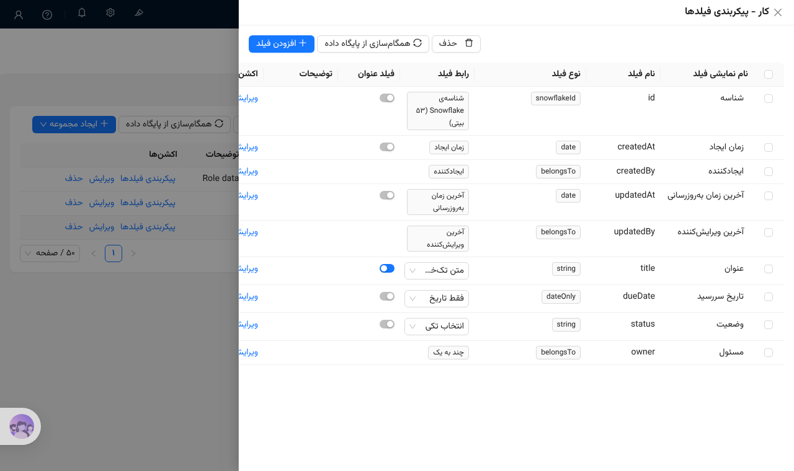
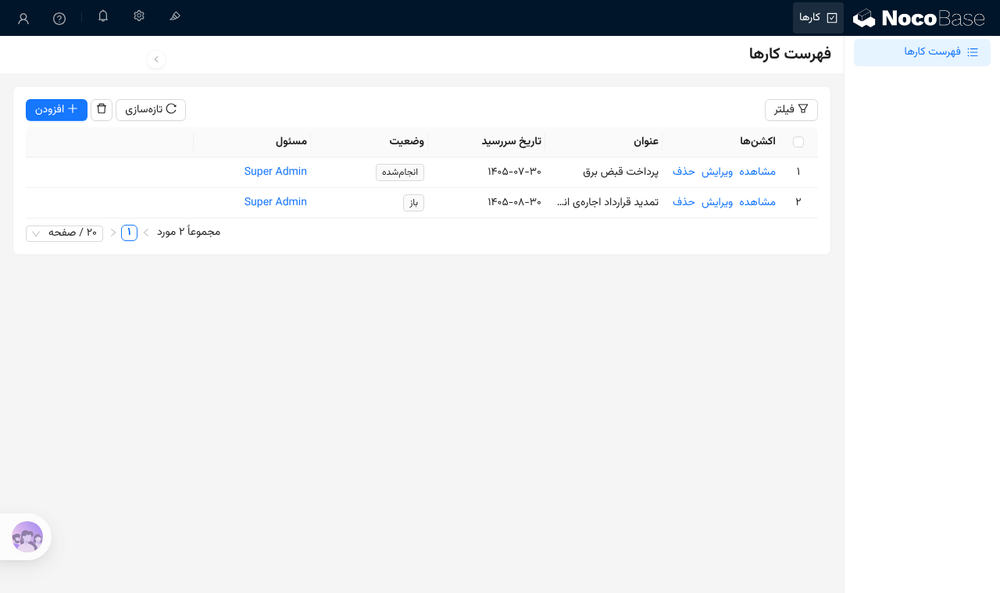
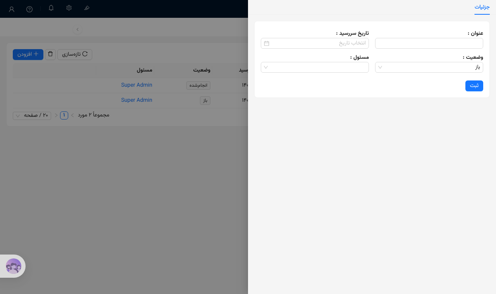
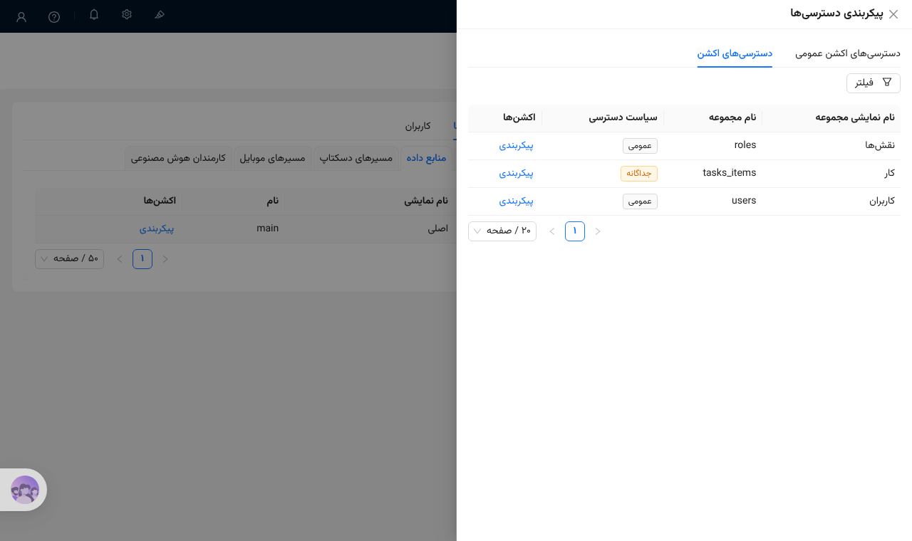
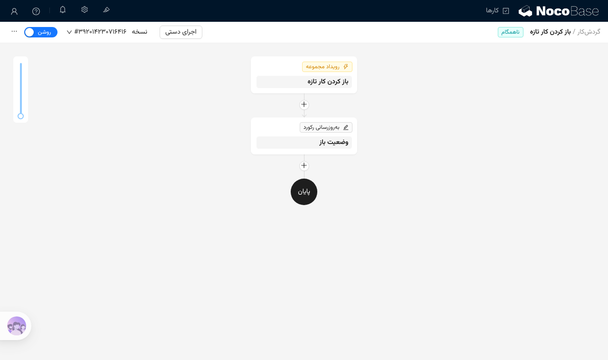
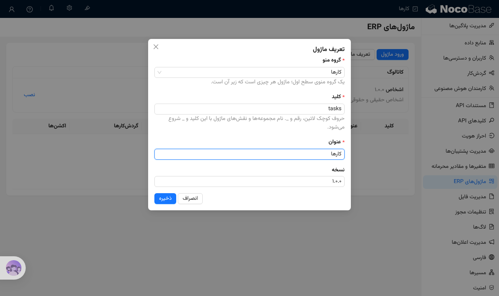
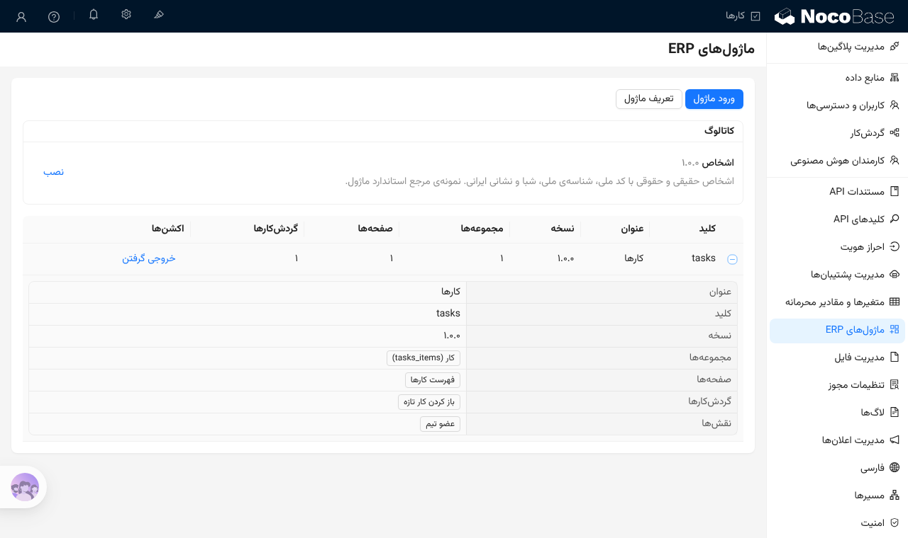

# راهنمای ساخت ماژول ERP

این راهنما یک ماژول کوچک را از صفر می‌سازد: ماژول «کارها»، با یک جدول کار، یک صفحه، یک نقش و یک گردش‌کار. همه‌ی گام‌ها در رابط بدون‌کد NocoBase فارسی انجام می‌شوند. در پایان ماژول در یک فایل است و در نصب دیگر وارد می‌شود.

هر گام به قاعده‌ی مربوطش در [استاندارد کیفیت ماژول](standard.md) پیوند دارد. ماژولی که این گام‌ها را دنبال کند، `yarn check:module` را بدون خطا می‌گذراند.

## ۱. انتخاب کلید

کلید نام کوتاه لاتین ماژول است، مثل `tasks`. پیش از ساختن هر چیزی آن را انتخاب کنید، چون نام جدول‌ها و نقش‌ها با آن شروع می‌شود.
- ۲ تا ۲۰ نویسه: حرف کوچک لاتین، رقم و `_`، و با حرف شروع شود.
- کلیدی را انتخاب کنید که ماژول دیگری در نصب ندارد.

در این راهنما کلید `tasks` است. قاعده: [M001](standard.md#m001).

## ۲. ساختن گروه منو

ماژول یعنی هر چیزی که زیر یک گروه منوی سطح اول است. گروه منو را با عنوان فارسی بسازید: در حالت ویرایش رابط، با دکمه‌ی «+» در منوی بالا یک «گروه» با عنوان «کارها» بسازید. همه‌ی صفحه‌های ماژول زیر همین گروه می‌آیند.

در تصویر گام ۴ گروه «کارها» در منوی بالا دیده می‌شود. قاعده: [M002](standard.md#m002).

## ۳. ساختن مجموعه‌ها

در «تنظیمات ← منبع داده ← اصلی» مجموعه‌ی تازه بسازید.
- **نام:** با کلید و `_` شروع شود، مثل `tasks_items`. قاعده: [M001](standard.md#m001).
- **عنوان:** فارسی، مثل «کار». عنوان هر فیلد هم فارسی است. «ی» و «ک» فارسی را به کار ببرید، نه «ي» و «ك» عربی. قاعده: [M002](standard.md#m002).
- **تاریخ:** تاریخ را در فیلد تاریخ نگه دارید، نه در فیلد متنی، تا جلالی نشان داده شود و مرتب شود. قاعده: [M003](standard.md#m003).
- **فیلدهای ایرانی:** برای کد ملی، شناسه‌ی ملی، شبا، کد پستی، تلفن همراه و مبلغ، نوع فیلد ایرانی را انتخاب کنید. قاعده: [M004](standard.md#m004).

مجموعه‌ی «کار» این فیلدها را دارد: عنوان (متن تک‌خطی)، تاریخ سررسید (فقط تاریخ)، وضعیت (انتخاب تکی: باز یا انجام‌شده) و مسئول (چند به یک، به کاربران).



## ۴. ساختن صفحه‌ها

زیر گروه «کارها» صفحه‌ی «فهرست کارها» را بسازید و در آن یک بلوک جدول از مجموعه‌ی «کار» بگذارید. دکمه‌های افزودن و ویرایش، فرمی با همان فیلدها باز می‌کنند. صفحه‌ی کلاسیک و مدرن هر دو در ماژول می‌آیند.





اگر صفحه جدولی از بیرون ماژول نشان دهد، مثلاً «کاربران»، آن جدول باید در بخش `requires` فایل باشد. خروجی گرفتن این بخش را خودش پر می‌کند. قاعده: [M007](standard.md#m007).

## ۵. ساختن نقش محدود

در «تنظیمات ← کاربران و دسترسی‌ها ← نقش‌ها» نقش تازه‌ای برای کاربران روزمره‌ی ماژول بسازید.
- **نام:** با کلید شروع شود، مثل `tasks_member`. **عنوان:** فارسی، مثل «عضو تیم». قاعده‌ها: [M001](standard.md#m001) و [M002](standard.md#m002).
- **سیستم:** پیکربندی رابط و تنظیمات را به این نقش ندهید.
- **منابع داده:** دسترسی عمومی را بسته بگذارید. در «دسترسی‌های اکشن» برای مجموعه‌ی «کار» دسترسی جداگانه بدهید: مشاهده، افزودن و ویرایش. فیلدهایی را که نقش می‌بیند، صریح انتخاب کنید.
- **مسیرهای دسکتاپ:** فقط منوی «کارها» را انتخاب کنید.

قاعده: [M005](standard.md#m005).



## ۶. ساختن گردش‌کار

در «تنظیمات ← گردش‌کار» گردش‌کار تازه بسازید. عنوان فارسی بدهید و در «توضیحات» بنویسید چه زمانی اجرا می‌شود و چه می‌کند. کسی که ماژول را وارد می‌کند، گردش‌کار را از همین توضیح می‌شناسد.

گردش‌کار «باز کردن کار تازه» با رویداد مجموعه روی «کار» اجرا می‌شود. توضیحش این است: «وقتی کار تازه‌ای ثبت شود، وضعیتش را «باز» می‌گذارد.»

گردش‌کاری جزو ماژول است که روی جدول‌های ماژول کار کند، یا دکمه‌ای در صفحه‌های ماژول آن را اجرا کند. قاعده: [M006](standard.md#m006).



## ۷. تعریف ماژول

«تنظیمات ← ماژول‌های ERP» را باز کنید و «تعریف ماژول» را بزنید.
- **گروه منو:** «کارها».
- **کلید:** `tasks`.
- **عنوان:** «کارها».



## ۸. خروجی گرفتن

ماژول در فهرست می‌آید. با باز کردن ردیف ببینید چه چیزهایی در ماژول است: مجموعه‌ها، صفحه‌ها، گردش‌کارها و نقش‌ها. اگر چیزی کم است، معمولاً نامش با کلید شروع نمی‌شود یا بیرون گروه منو است.

«خروجی گرفتن» فایل `tasks.erp-module.json` را می‌دهد. این فایل در نصب دیگر از همین صفحه با «ورود ماژول» وارد می‌شود.



## ۹. بررسی با `yarn check:module`

فایل خروجی را با ابزار استاندارد بسنجید:

```bash
yarn check:module tasks.erp-module.json
```

```text
tasks.erp-module.json: 0 error(s), 0 warning(s)
```

هر خطا شناسه‌ی قاعده و جای آن در فایل را می‌گوید، مثل `ERROR M002 ...`. توضیح هر قاعده در [استاندارد](standard.md) است. خطا را در رابط درست کنید و دوباره خروجی بگیرید. فایل را دستی ویرایش نکنید.

برای فرستادن ماژول به کاتالوگ، [فرایند بازبینی ماژول](../process/module-review.md) را ببینید.

## گرفتن دوباره‌ی تصویرها

تصویرهای این راهنما را یک اسکریپت Playwright روی یک نصب در حال اجرا می‌گیرد. اسکریپت ماژول «کارها» را با همین گام‌ها می‌سازد، از هر گام تصویر می‌گیرد، فایل خروجی را با `check:module` می‌سنجد و در پایان همه را پاک می‌کند. پس از ارتقای NocoBase این دستور را اجرا کنید:

```bash
APP_PORT=13000 yarn docs:module-guide
```

نشانی نصب با `APP_PORT` یا `APP_BASE_URL` داده می‌شود. حساب مدیر همان حساب آزمون‌های e2e است (`INIT_ROOT_EMAIL` و `INIT_ROOT_PASSWORD`). اسکریپت در [`tools/module-guide/guide.shots.ts`](../../tools/module-guide/guide.shots.ts) است و تصویرها در `docs/modules/images/` ذخیره می‌شوند.
