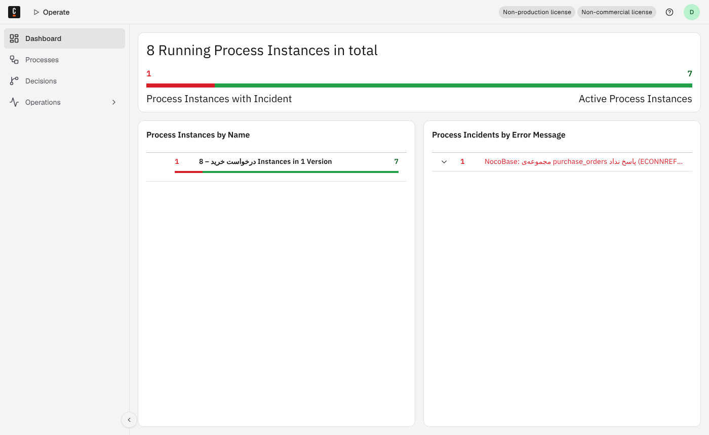
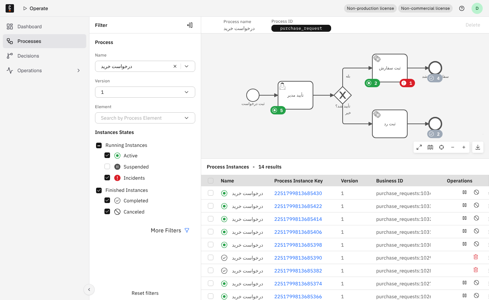
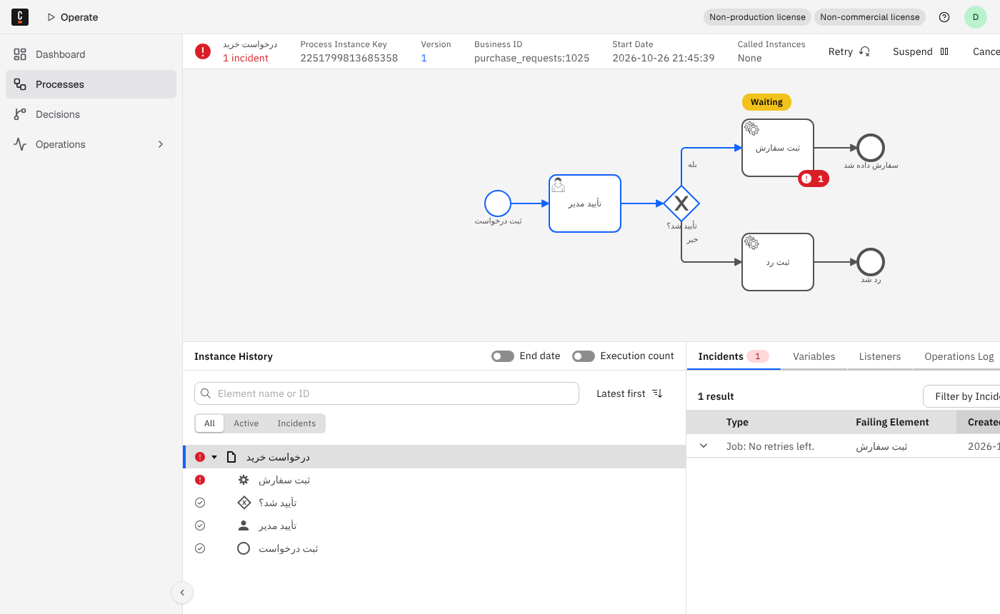
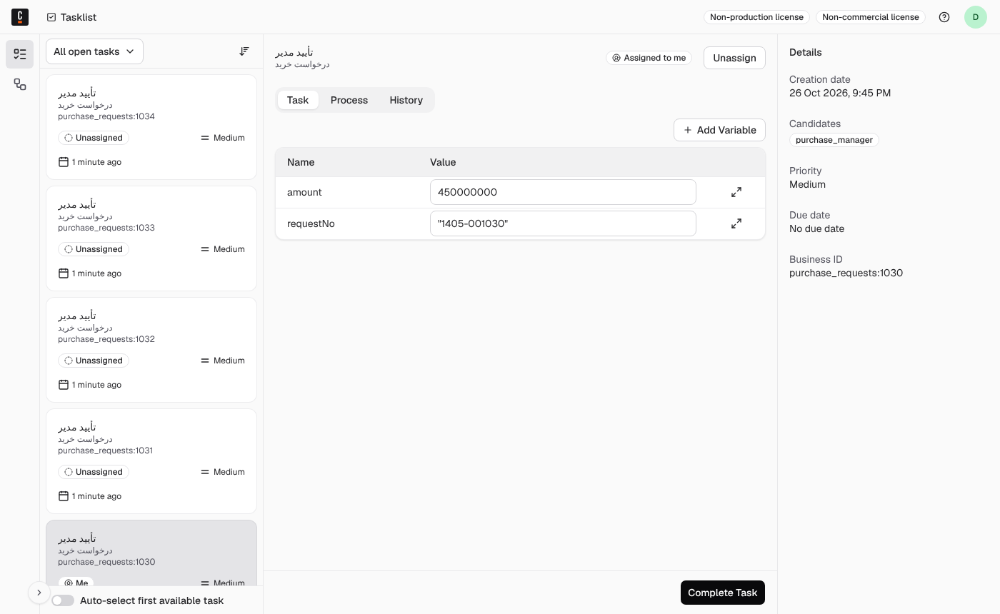

# سکوی فرایند: طراحی، مدیریت و پایش فرایند داخل NocoBase

> وضعیت: **پیشنهاد برای تأیید صاحب پروژه** (۱۴۰۵/۰۸/۰۴). اپیک این طرح [EPIC-021](../../backlog/epics/EPIC-021-process-platform/epic.md) است. موتور در [تصمیم ۰۰۰۸](../decisions/0008-camunda8-and-two-builders.md) آمده است.
> ماکاپ صفحه‌ها: [ماکاپ سکوی فرایند](https://claude.ai/artifact/3aWuw9aWzVPFMCX85L9Dwf). فقط صاحب پروژه می‌تواند بازش کند، مگر آن را هم‌رسانی کند.

## خلاصه

امروز موتور فرایند (Operaton، هم‌خانواده‌ی Camunda 7) به NocoBase وصل است و فرایند نمونه‌ی «درخواست خرید» از ابتدا تا انتها کار می‌کند ([EPIC-016](../../backlog/epics/EPIC-016-bpmn-engine/epic.md) و [گزارش PoC](../research/bpmn-poc.md)). ولی مدل بیرون از برنامه ساخته می‌شود، صفحه‌ای برای دیدن نمونه‌ها نیست و خطاها فقط با REST موتور دیده می‌شوند.

دو تصمیم صاحب پروژه این طرح را شکل می‌دهند:

- **موتور BPMN، Camunda 8.10.7 است**، آخرین نسخه‌ی پایدار. ذخیره‌ی ثانویه‌اش روی همان PostgreSQL است و Elasticsearch نمی‌خواهد. مجوز Camunda 8 فقط محیط غیرعملیاتی را می‌پوشاند ([تصمیم ۰۰۰۸](../decisions/0008-camunda8-and-two-builders.md#مجوز-camunda-8)).
- **دو سازنده‌ی فرایند.** کاربر هر فرایند را یا با گردش‌کار خود NocoBase می‌سازد یا با BPMN در Camunda.

این طرح یک منوی «فرایندها» داخل NocoBase می‌سازد که همه‌چیز در آن فارسی و راست‌به‌چپ است و برای هر دو سازنده یکی است:

1. **طراحی فرایند:** انتخاب سازنده، سپس بوم گردش‌کار NocoBase یا ویرایشگر BPMN داخل برنامه. پنل ویژگی‌ها نقش‌ها، فرم‌ها و گردش‌کارهای NocoBase را می‌شناسد.
2. **وصل کردن فرایند به منو:** کارت شروع، دکمه روی جدول، بلوک وضعیت در صفحه‌ی رکورد، و کارتابل واحد.
3. **مدیریت فرایندها:**
   - شمار نمونه‌ها در هر فرایند
   - اینکه هر نمونه الان کجاست
   - تاریخچه
   - کارهای مدیر: واگذاری، تعلیق، لغو و انتقال به نسخه‌ی تازه
4. **لاگ و پایش:**
   - لاگ اتصال با شناسه‌ی پیگیری
   - خطاها با تلاش دوباره
   - دیرکردها
   - سلامت موتور و هشدار

Operate و Tasklist خود Camunda فقط برای مدیر فنی‌اند و از بیرون باز نمی‌شوند.

## دو سازنده‌ی فرایند

| | گردش‌کار NocoBase | BPMN در Camunda 8 |
| --- | --- | --- |
| مناسب برای | تأیید یک یا دو مرحله‌ای، کار خودکار روی یک مجموعه، اعلان، محاسبه | فرایند چندنفره و چندروزه، مسیرهای موازی، تایمر و پیام، نسخه و انتقال نمونه‌ها، ممیزی کامل |
| ویرایشگر | بوم گردش‌کار NocoBase، بدون تغییر | bpmn-js داخل NocoBase (بخش ۱) |
| کار انسانی | نود «کار انسانی» | `zeebe:userTask` |
| موتور جدا | ندارد | Camunda 8 |
| مجوز | مجوز NocoBase | Camunda License 1.0: فقط غیرعملیاتی |
| داده‌ی پایش | مجموعه‌های `executions` و `jobs` خود NocoBase | REST API v2 موتور |
| ابزار فنی | تاریخچه‌ی اجرای گردش‌کار در NocoBase | Operate و Tasklist |

**انتخاب سازنده.** «فرایند تازه» در «طراحی فرایند» دو کارت دارد: «گردش‌کار NocoBase (ساده)» و «فرایند BPMN (پیشرفته)». هر کارت چند جمله راهنما دارد که از جدول بالا می‌آید. سازنده بعداً عوض نمی‌شود، چون تبدیل خودکار گردش‌کار به BPMN در دامنه نیست.

**فهرست فرایندها.** مجموعه‌ی `bpmProcesses` هر فرایند را با سازنده‌اش ثبت می‌کند:
- گردش‌کار NocoBase با `key` گردش‌کار
- فرایند Camunda با `processDefinitionId`

نام، دسته، ماژول، صاحب فرایند، نقش‌های مجاز به شروع و جای منو هم در همین ردیف است. همه‌ی صفحه‌های «فرایندها» از همین فهرست شروع می‌کنند. هر گردش‌کار NocoBase فرایند حساب نمی‌شود: فقط آن‌هایی که طراح «فرایند» علامت بزند در فهرست می‌آیند.

**پل میان دو سازنده.** هر دو در EPIC-016 ساخته شده‌اند:
- نود «شروع فرایند BPMN» در گردش‌کار NocoBase یک فرایند Camunda را شروع می‌کند.
- رویداد «کار سرویس BPMN» کار سرویس Camunda را با یک گردش‌کار NocoBase انجام می‌دهد.

پس فرایند Camunda می‌تواند کارهای داده‌ای‌اش را به گردش‌کارهای NocoBase بسپارد.

## آنچه از Bizagi، Axelor و ProcessMaker برمی‌داریم

| ایده | از کجا | در طرح ما |
| --- | --- | --- |
| ویرایشگر BPMN داخل خود برنامه با bpmn-js، پنل ویژگی‌ها، بررسی مدل (bpmnlint) و شبیه‌سازی | Axelor Studio BPM (bpmn-js با موتور Camunda) | صفحه‌ی «طراحی فرایند»، دکمه‌های «بررسی مدل» و «اجرای آزمایشی» |
| طراحی گام‌به‌گام در زبانه‌های پشت سر هم: مدل، داده، فرم‌ها، مسئول‌ها، قاعده و مهلت، منو | Bizagi Studio | زبانه‌های بالای «طراحی فرایند» |
| مرحله‌ی کار انسانی به یک نمای داده‌ی موجود وصل است و فیلدها را در آن مرحله پنهان، الزامی یا فقط‌خواندنی می‌کند | Axelor | فرم کار = فرم NocoBase روی همان مجموعه |
| تنظیم هر کار: فرم، مهلت، نوع واگذاری (گروهی و برداشتن، درخواست‌دهنده، مسئول قبلی، قاعده)، اجازه‌ی واگذاری، اعلان، تشدید به مدیر | ProcessMaker | پنل ویژگی‌های فارسی |
| کاتالوگ شروع فرایند با دسته‌بندی، شرح و دکمه‌ی «شروع» | ProcessMaker Launchpad، Bizagi «مورد تازه» | «شروع فرایند» و کارت‌های «درخواست‌های من» |
| دکمه‌ی «گردش فرایند» روی هر رکورد | Axelor | بلوک «وضعیت فرایند» در صفحه‌ی رکورد |
| کارتابل با مهلت، شمارنده‌ی دیرکرد، اولویت، صف گروهی با «برداشتن» | ProcessMaker | کارتابل یکپارچه |
| چراغ راهنمایی مهلت: سبز به‌موقع، زرد در خطر، قرمز دیرکرد | Bizagi | برچسب مهلت در کارتابل و فهرست نمونه‌ها |
| پیگیری درخواست برای درخواست‌دهنده: مرحله‌های طی‌شده سبز، مرحله‌ی فعلی آبی، بقیه خاکستری | ProcessMaker | «درخواست من کجاست» و صفحه‌ی نمونه |
| شمار نمونه و خطا روی هر گره‌ی نمودار | Axelor «BPM State»، Operate | صفحه‌ی یک فرایند |
| صفحه‌ی انتقال نمونه‌ها به نسخه‌ی تازه با نگاشت گره‌ها و گزارش شکست | Axelor | «انتقال به نسخه‌ی دیگر» |
| پایش کسب‌وکار: به‌موقع، در خطر و دیرکرد برای هر فرایند و هر مرحله، بار کاری هر نفر | Bizagi BAM، داشبورد Axelor | «پایش و هشدارها» و «زمان هر مرحله» |
| تقویم کاری و تعطیلات که بدون استقرار دوباره عوض می‌شود | Bizagi | تقویم کاری شمسی برای مهلت‌ها |
| کنسول کارهای ناهمگام شکست‌خورده | Bizagi | فهرست خطاها با «تلاش دوباره» |

ProcessMaker مجوز AGPL دارد و ویرایشگرش bpmn-js نیست. پس از آن فقط ایده‌ی رابط کاربری را برمی‌داریم. Bizagi ویرایشگر رومیزی دارد، که با هدف «همه‌چیز داخل NocoBase» نمی‌خواند.

## منوی «فرایندها»

یک منوی بالای NocoBase با این بخش‌ها. هر بخش را ACL نقش‌ها نشان می‌دهد یا پنهان می‌کند.

| بخش | برای چه کسی | صفحه در ماکاپ |
| --- | --- | --- |
| کارتابل من | همه | ۵ |
| شروع فرایند | هر نقشی که اجازه‌ی شروع دارد | ۶ |
| درخواست‌های من | همه | ۶ |
| مدیریت فرایندها | مدیر فرایند | ۲، ۳ و ۴ |
| پایش و هشدارها | مدیر فرایند و مدیر فنی | ۷ |
| طراحی فرایند | طراح فرایند | ۱ |
| گزارش‌های فرایند | مدیر فرایند | (گام بعد) |

این صفحه‌ها صفحه‌های معمولی NocoBase با بلوک‌های تازه‌ی `plugin-bpm` هستند. پس سازنده‌ی صفحه می‌تواند آن‌ها را جابه‌جا کند یا در منوی یک واحد هم بگذارد.

## ۱. طراحی فرایند داخل NocoBase

**گردش‌کار NocoBase.** بوم خود NocoBase بدون تغییر می‌ماند. «طراحی فرایند» فقط فرایند را در `bpmProcesses` ثبت می‌کند، بوم را باز می‌کند و زبانه‌های «منو» و «مهلت» را اضافه می‌کند. مسئول کار در نود «کار انسانی» خود NocoBase تعیین می‌شود.

**فرایند BPMN:**

- **ویرایشگر:** `bpmn-js` (Modeler) با `bpmn-js-properties-panel` و `zeebe-bpmn-moddle`، در صفحه‌ی «طراحی فرایند». خروجی یک فایل BPMN 2.0 استاندارد با افزونه‌های `zeebe:` است و در Camunda Modeler هم باز می‌شود.
- **زبانه‌های گام‌به‌گام**، مثل Bizagi: «مدل»، «داده» (مجموعه‌ی فرایند)، «فرم‌ها»، «مسئول‌ها»، «قاعده و مهلت» و «منو». طراح می‌تواند به هر زبانه برگردد. «بررسی مدل» کمبود هر زبانه را نشان می‌دهد.
- **پنل ویژگی‌های فارسی و آگاه از NocoBase.** به جای جعبه‌های متنی Camunda، فهرست‌های انتخابی از خود NocoBase:
  - مسئول: نقش NocoBase (`zeebe:assignmentDefinition candidateGroups`)، کاربر، درخواست‌دهنده، یا مسئول مرحله‌ی قبل.
  - فرم: فرمی از NocoBase روی مجموعه‌ی همان فرایند، با فیلدهای الزامی و فقط‌خواندنی در این مرحله (`zeebe:formDefinition` با `externalReference`).
  - کار سرویس: یک گردش‌کار NocoBase از نوع «کار سرویس BPMN». نوع کار (`zeebe:taskDefinition type`) از آن ساخته می‌شود.
  - مهلت: مدت (مثلاً «۲ روز کاری») روی تقویم کاری شمسی، و کار پس از مهلت (یادآوری، تشدید به مدیر).
  - تصمیم‌ها: دکمه‌های کار انسانی (تأیید، رد، برگشت برای اصلاح) که به متغیر خروجی تبدیل می‌شوند.

  این‌ها با element template برای Camunda 8 یا یک `PropertiesProvider` سفارشی ساخته می‌شوند تا فایل BPMN استاندارد بماند.
- **ترجمه:** ماژول `translate` در bpmn-js همه‌ی برچسب‌های ویرایشگر و پنل را از یک واژه‌نامه‌ی فارسی می‌گیرد. واژه‌ها از [`glossary/fa-IR.csv`](../../glossary/fa-IR.csv) می‌آیند: فرایند، نمونه‌ی فرایند، کار انسانی، کار سرویس، استقرار، کلید کسب‌وکار.
- **راست‌به‌چپ:**
  - bpmn-js راست‌به‌چپ را نمی‌شناسد. خود بوم چپ‌به‌راست می‌ماند، چون مختصات BPMN و ابزار رسم به آن وابسته‌اند.
  - فقط برچسب‌ها (`tspan{direction:rtl;unicode-bidi:embed}`)، پنل و نوار ابزار راست‌به‌چپ می‌شوند.
  - جهت جریان روی نمودار انتخاب طراح است. پیش‌فرض قالب‌های ما راست‌به‌چپ است، مثل ماکاپ.
  - برچسب‌های بلند فارسی در bpmn-js بد شکسته می‌شوند. قاعده‌ی شکستن خط باید آزمون تصویری شود.
- **بررسی و آزمایش:**
  - «بررسی مدل» با `bpmnlint` و چند قاعده‌ی خودمان: هر کار انسانی مسئول و فرم دارد، هر کار سرویس گردش‌کار دارد، هر دروازه مسیر پیش‌فرض دارد.
  - «اجرای آزمایشی» با `bpmn-js-token-simulation`، بدون موتور.
- **پیش‌نویس، استقرار و نسخه:**
  - طراح روی پیش‌نویس کار می‌کند.
  - «استقرار نسخه‌ی تازه» مدل را با `POST /v2/deployments` به موتور می‌دهد. موتور فایل یکسان با همان نام را نسخه‌ی تازه حساب نمی‌کند، ولی همان فایل با نام دیگر نسخه‌ی تازه می‌سازد (آزموده روی 8.10.7). پس نام فایل هر فرایند ثابت است: `<processId>.bpmn`.
  - نمونه‌های باز روی نسخه‌ی خودشان می‌مانند تا مدیر آن‌ها را منتقل کند.
  - هر استقرار با نام کاربر و زمان در لاگ می‌ماند.
- **نمودار همیشه DI دارد.** فایل BPMN بدون بخش نقشه (BPMN DI) در هیچ نمایشگری دیده نمی‌شود. مدل Operaton [`bpmn/operaton/purchase-request.bpmn`](../../bpmn/operaton/purchase-request.bpmn) DI ندارد. نسخه‌ی Camunda 8 آن با DI در [`bpmn/purchase-request.bpmn`](../../bpmn/purchase-request.bpmn) است و در Operate درست دیده شد (بخش ۷).
- **فرایند در ماژول ERP:**
  - قالب ماژول ([تصمیم ۰۰۰۵](../decisions/0005-erp-module-format.md)) مدل BPMN یا گردش‌کار فرایند را هم با خودش می‌برد.
  - ورود ماژول فرایند را مستقر می‌کند.
  - حذف ماژول نمونه‌های باز را با تأیید کاربر لغو می‌کند (پیشنهاد ۴ PoC).
- **مجوز bpmn-js:** مجوز bpmn.io شبیه MIT است، با یک شرط: نشان bpmn.io روی بوم نباید پاک یا پنهان شود. بقیه‌ی بسته‌ها MIT هستند.

## ۲. وصل کردن فرایند به منوها

هر فرایند مستقرشده، با هر سازنده‌ای، بدون کدنویسی به این جاها وصل می‌شود:

1. **کارت در «شروع فرایند»** برای نقش‌هایی که اجازه‌ی شروع دارند. شروع یک فرم NocoBase باز می‌کند و رکورد می‌سازد.
   - فرایند Camunda با کلید کسب‌وکار `<مجموعه>:<شناسه>` شروع می‌شود.
   - گردش‌کار NocoBase با رویداد «پس از اکشن» یا «اکشن سفارشی» روی همان رکورد اجرا می‌شود.
2. **دکمه یا رویداد روی یک مجموعه:** نود «شروع فرایند BPMN»، دکمه‌ی آماده روی جدول، یا رویداد شروع گردش‌کار.
3. **جادوگر «وصل به منو»:** فرایند را به منوی کسب‌وکار خودش وصل می‌کند، مثلاً «خرید». صفحه‌های «درخواست تازه»، «درخواست‌های من» و «کارتابل خرید» را می‌سازد که فقط همین فرایند را نشان می‌دهند.
4. **بلوک «وضعیت فرایند»** در صفحه‌ی جزئیات رکورد: مرحله‌های طی‌شده و فعلی، مسئول فعلی و پیوند به نمودار.

## ۳. مدیریت فرایندها و نمونه‌ها

| صفحه | چه نشان می‌دهد | فرایند Camunda | گردش‌کار NocoBase |
| --- | --- | --- | --- |
| مدیریت فرایندها (ماکاپ ۲) | هر فرایند: سازنده، نسخه‌ی فعال، در جریان، کار باز، خطا، دیرکرد، میانگین زمان، جای در منو | `/v2/process-definitions/statistics/process-instances` و `/v2/incidents/search`، و `bpmInstances` | `bpmInstances`، که از `executions` پر می‌شود |
| یک فرایند (ماکاپ ۳) | نمودار با شمار نمونه در هر مرحله (آبی)، دیرکرد (نارنجی) و خطا (قرمز)؛ نمونه‌ها با مرحله‌ی فعلی و مسئول؛ زمان هر مرحله؛ نسخه‌ها | `/v2/process-definitions/{key}/statistics/element-instances` و نمایشگر bpmn-js با `overlays` | شمار `jobs` در انتظار برای هر نود، روی بوم خود NocoBase |
| یک نمونه (ماکاپ ۴) | مسیر طی‌شده، تاریخچه با نام و زمان، داده‌ی نمونه، لاگ اتصال، کارهای مدیر | `/v2/process-instances/{key}/sequence-flows`، `/v2/element-instances/search`، `/v2/incidents/search` و `bpmEvents` | اجرای گردش‌کار با `jobs` آن |

کارهای مدیر فرایند، هر کدام با ثبت نام، زمان و دلیل:

| کار | فرایند Camunda | گردش‌کار NocoBase |
| --- | --- | --- |
| واگذاری کار به شخص دیگر | `/v2/user-tasks/{key}/assignment` | واگذاری در کار انسانی NocoBase |
| تعلیق و ادامه | `/v2/process-instances/{key}/suspension` و `/resumption` | ندارد |
| لغو با دلیل | `/v2/process-instances/{key}/cancellation` | لغو اجرا (اکشن `executions:cancel`) |
| بردن به مرحله‌ی دیگر | `/v2/process-instances/{key}/modification` | ندارد |
| انتقال به نسخه‌ی دیگر، تکی یا گروهی | `/v2/process-instances/{key}/migration` و `/v2/process-instances/migration` | ندارد؛ اجرای باز روی نسخه‌ی خودش تمام می‌شود |

دکمه‌ی کاری که سازنده ندارد پنهان است. همه‌ی APIهای Camunda در این جدول روی 8.10.7 هستند و بی‌کلید مجوز کار می‌کنند ([آزمون دستی](../decisions/0008-camunda8-and-two-builders.md#آزمون-دستی)).

## ۴. کارتابل و پیگیری درخواست

- **کارتابل یکپارچه.** NocoBase یک مرکز کار دارد که کارهای نود «کار انسانی» گردش‌کار در آن می‌آیند. کارهای انسانی Camunda هم با `registerTaskType` در کلاینت و `updateTasksStats` در سرور `plugin-workflow` به همان مرکز اضافه می‌شوند. کاربر یک فهرست می‌بیند، با برچسب فرایند. کارهای هر دو سازنده این‌ها را دارند:
  - زبانه‌های «به من»، «گروه من» و «دیرکرد»
  - «برداشتن کار» برای کار گروهی
  - برچسب مهلت سبز، زرد و قرمز
  - صفحه‌بندی سمت سرور

  این‌ها پرسش‌های باز [STORY-082](../../backlog/epics/EPIC-016-bpmn-engine/STORY-082-task-inbox.md) را می‌بندند.
- **فرم کار = فرم NocoBase.** طراح یک فرم NocoBase روی همان مجموعه انتخاب می‌کند. فیلدهای رکورد در همان فرم ویرایش می‌شوند و فقط تصمیم‌ها به موتور می‌روند. مالکیت داده طبق [تصمیم ۰۰۰۷](../decisions/0007-bpmn-engine.md) می‌ماند: داده‌ی کسب‌وکار در NocoBase، تصمیم و کلید در موتور.
- **درخواست من کجاست.** برای درخواست‌دهنده، مرحله‌ها به شکل گام‌نما دیده می‌شوند: «نزد چه کسی، از کی، تا کی». اگر کار به او برگشته باشد («برگشت برای اصلاح»)، بالای فهرست می‌آید.
- **مهلت و تقویم کاری:**
  - مهلت بر حسب «روز کاری» روی تقویم شمسی با تعطیلات رسمی است.
  - تعطیلات از یک مجموعه‌ی NocoBase خوانده می‌شود و بدون استقرار دوباره عوض می‌شود.
  - پلاگین مهلت را هنگام ساخت کار از روی تقویم حساب می‌کند. در Camunda آن را در `dueDate` کار می‌نویسد. موتور و پایگاه داده UTC نگه می‌دارند.

## ۵. لاگ، ردیابی و منبع حقیقت

**لاگ اتصال `bpmEvents`.** یک مجموعه در NocoBase که هر تبادل با Camunda یک ردیف در آن است:

- زمان و جهت (NocoBase ← موتور، موتور ← NocoBase، همگام‌سازی، بازبینی)
- فرایند، کلید کسب‌وکار، شناسه‌ی نمونه
- رویداد (شروع، پیام، انجام کار، برداشتن، واگذاری، کار سرویس، خطا، استقرار، کار مدیر)
- کاربر NocoBase، شناسه‌ی پیگیری، مدت، نتیجه، خلاصه‌ی خطا

شناسه‌ی پیگیری (correlation id) در سربرگ درخواست به موتور و در لاگ سرور NocoBase هم نوشته می‌شود. پس یک رویداد را می‌شود از دکمه تا موتور دنبال کرد.

**این لاگ تنها جای نام کاربر واقعی است.** لاگ ممیزی خود موتور همه‌ی کارها را به نام کاربر سرویس پلاگین می‌نویسد. این را در آزمون Operaton دیدیم و Camunda 8 هم با یک کاربر سرویس همین است.

داده‌ی فرم و رمزها در لاگ نوشته نمی‌شوند. لاگ پس از ۹۰ روز پاک می‌شود و این مدت قابل تنظیم است. گردش‌کار NocoBase لاگ جدا لازم ندارد، چون اجرا و کارهایش در پایگاه داده‌ی خود NocoBase است.

**جدول `bpmInstances`.** تصویری از هر نمونه‌ی هر دو سازنده در NocoBase: فرایند، سازنده، نسخه، کلید، رکورد، درخواست‌دهنده، وضعیت، مرحله‌ی فعلی، مسئول فعلی، مهلت، زمان شروع و پایان.

- **گردش‌کار NocoBase:** رویدادهای پایگاه داده روی `executions` و `jobs` ردیف را همان لحظه به‌روز می‌کنند. مرحله‌ی فعلی، نود `job` در انتظار است.
- **فرایند Camunda:** سه راه ردیف را تازه نگه می‌دارند:
  1. هر کاری که از NocoBase به موتور می‌رود، پس از موفقیت، همین ردیف را به‌روز می‌کند.
  2. Worker هر چند ثانیه نمونه‌ها و کارهای انسانی تغییرکرده را با `/v2/process-instances/search` و `/v2/user-tasks/search` می‌خواند.
  3. بازبینی شبانه همه‌ی نمونه‌های باز را با موتور مقایسه می‌کند. اختلاف را در لاگ می‌نویسد و درست می‌کند.

منبع حقیقت وضعیت فرایند **همیشه موتور** است: Camunda یا `executions` خود NocoBase. `bpmInstances` فقط برای فهرست، فیلتر، گزارش و ACL است. با آن، «درخواست‌های من» و گزارش‌ها بدون صدها درخواست به موتور کار می‌کنند. ACL، فیلتر و خروجی اکسل NocoBase هم رویش کار می‌کنند.

**صف ارسال (outbox).**
- شروع فرایند Camunda و فرستادن پیام اول در جدول `bpmOutbox` و در همان تراکنش رکورد نوشته می‌شوند.
- Worker آن‌ها را با تلاش دوباره و فاصله‌ی رو به افزایش می‌فرستد. اگر موتور خاموش باشد، ثبت رکورد خراب نمی‌شود و درخواست بعداً فرستاده می‌شود (پیشنهاد ۱ PoC).
- یکتایی کلید کسب‌وکار در خود Camunda، فرستادن دوباره را بی‌خطر می‌کند.

**تاریخچه‌ی موتور.**
- Camunda نمونه‌های تمام‌شده را پس از `default-history-ttl` از ذخیره‌ی ثانویه پاک می‌کند. پیش‌فرض موتور ۳۰ روز است و ما ۱۸۰ روز می‌گذاریم.
- ذخیره‌ی اصلی Zeebe پس از صدور داده خودش فشرده می‌شود.
- پیش از پاک شدن، خلاصه‌ی هر نمونه در `bpmInstances` می‌ماند. پس گزارش‌های قدیمی از بین نمی‌روند.

**لاگ خود موتور.** به stdout کانتینر می‌رود. قالب JSON و سطح هر بخش در STORY-091 تنظیم می‌شود.

## ۶. پایش و هشدار

| چه چیزی | چطور | هشدار پیش‌فرض |
| --- | --- | --- |
| سلامت Camunda | `/actuator/health` روی درگاه 9600، هر ۳۰ ثانیه | ۲ دقیقه بی‌پاسخ: ایمیل و اعلان به مدیر فنی |
| کارگر کار سرویس | زمان آخرین `jobs/activation` موفق و `/v2/jobs/statistics/by-types` | بیش از ۵ دقیقه بی‌دریافت |
| صف ارسال | شمار ردیف‌های در انتظار و قدیمی‌ترین | بیش از ۱۰ مورد یا بیش از ۱۰ دقیقه |
| خطای فرایند Camunda | `/v2/incidents/search` | خطای تازه: اعلان به مدیر فنی و مدیر فرایند |
| خطای گردش‌کار NocoBase | اجراهای با وضعیت شکست یا خطا در `executions` | همان |
| دیرکرد | `bpmInstances.due` و کارهای باز | یادآوری به مسئول؛ پس از ۱ روز به مدیر او |
| همگام‌سازی | نتیجه‌ی بازبینی شبانه | هر اختلاف |
| فضای موتور | حجم پایگاه داده‌ی `camunda` و volume موتور | رشد غیرعادی |

هشدارها با سامانه‌ی اعلان NocoBase فرستاده می‌شوند (درون‌برنامه و ایمیل). پیامک به درگاه پیامک بستگی دارد (پرسش باز).

Camunda 8 متریک Prometheus را آماده دارد (`/actuator/prometheus` روی درگاه 9600). پلاگین هم یک `/metrics` اختیاری برای صف، دیرکرد و خطا می‌دهد. داشبورد Grafana در گام اول لازم نیست.

## ۷. ابزار خود موتور: Operate و Tasklist

Camunda 8 دو رابط وب دارد: **Operate** برای دیدن و تعمیر نمونه‌ها، و **Tasklist** برای کارهای انسانی. برای کاربران لازم نیستند، چون صفحه‌های بالا همین کار را فارسی انجام می‌دهند. ولی برای مدیر فنی ابزار خوبی برای عیب‌یابی‌اند.

تصویرها از Camunda 8.10.7 با همین «درخواست خرید» و ۱۴ نمونه گرفته شده‌اند. برچسب‌های «Non-production license» و «Non-commercial license» بالای هر صفحه، نشانه‌ی نبود کلید مجوز است.

| داشبورد | یک فرایند با شمار نمونه روی هر مرحله |
| --- | --- |
|  |  |
| **یک نمونه با خطای کار سرویس** | **Tasklist با کلید کسب‌وکار** |
|  |  |

آنچه در تصویرها پیداست:
- برچسب‌های فارسی مرحله‌ها درست دیده می‌شوند.
- ستون «Business ID» در فهرست نمونه‌ها و جزئیات کار هست.
- Operate دکمه‌های Retry، Suspend و Cancel، تاریخچه‌ی نمونه و زبانه‌ی خطاها را دارد.

برخلاف Cockpit رایگان Camunda 7، تاریخچه و انتقال نمونه در Operate هست. ولی رابط فارسی و راست‌به‌چپ ندارد و استفاده‌ی عملیاتی از آن هم مجوز می‌خواهد.

**دسترسی به Operate و Tasklist.** درگاه موتور بیرون نیست و همین‌طور می‌ماند. هر مدیر فنی یک کاربر جدای Camunda دارد، نه کاربر سرویس پلاگین. دسترسی فقط با تونل SSH به شبکه‌ی داخلی Docker است. مسیر محافظت‌شده در پراکسی NocoBase پرسش باز است.

## ۸. نکته‌های فنی اتصال

بر پایه‌ی مستندات Camunda 8.10 و آزمون روی 8.10.7:

1. **فقط REST API v2، فقط از راه `BpmEngine`.** جدول‌های پایگاه داده‌ی `camunda` در همان PostgreSQL ما هستند، ولی پلاگین هیچ‌وقت مستقیم به آن‌ها نمی‌زند. ساختارشان داخلی است و با هر نسخه عوض می‌شود.
2. **سازگاری با تأخیر.** جست‌وجوها (`.../search` و آمار) از ذخیره‌ی ثانویه می‌خوانند. این ذخیره چند لحظه پس از هر فرمان به‌روز می‌شود. پس پلاگین بلافاصله پس از یک فرمان به جست‌وجو تکیه نمی‌کند و کلیدی را که خود فرمان برمی‌گرداند نگه می‌دارد.
3. **کار سرویس با long polling.** `jobs/activation` با `requestTimeout` (مثلاً ۲۰ ثانیه) به جای پرسیدن هر چند ثانیه. `timeout` کار دست‌کم برابر زمان انجام آن است.
4. **شکست کار سرویس.**
   - در `failure` شمار تلاش را **خود Worker کم می‌کند**، با `retryBackOff` رو به افزایش. در صفر، موتور خطا (incident) می‌سازد.
   - «تلاش دوباره» یعنی بالا بردن تلاش با `PATCH /v2/jobs/{key}` و رفع خطا با `/v2/incidents/{key}/resolution`.
   - خطای کسب‌وکار («تأمین‌کننده ندارد») با `/v2/jobs/{key}/error` و `errorCode` به رویداد مرزی می‌رود.
5. **دست‌کم یک بار.** اگر زمان کار تمام شود، کار دوباره داده می‌شود. پس هر اثر در NocoBase با `jobKey` یکتا می‌شود (جدول اثرهای انجام‌شده).
6. **کلید کسب‌وکار.**
   - `<collection>:<id>` همان قاعده‌ی امروز است و در `businessId` نمونه نوشته می‌شود.
   - یکتایی را باید در تنظیمات روشن کرد. فقط برای نمونه‌های باز ریشه‌ی همان فرایند است.
   - پس از شروع عوض نمی‌شود و حداکثر ۲۵۶ نویسه است.
   - کارهای انسانی و کارهای سرویس آن را با خود دارند.
7. **پیام.**
   - `messages/correlation` هم‌زمان است. اگر نمونه‌ای منتظر نباشد، ۴۰۴ برمی‌گرداند.
   - `messages/publication` با `timeToLive` پیام را نگه می‌دارد تا نمونه به آن برسد. برای پیامی که ممکن است زودتر از رسیدن نمونه بیاید، publication به کار می‌رود.
   - `correlationKey` همان کلید کسب‌وکار است.
8. **هویت.** کاربران NocoBase در موتور ساخته نمی‌شوند. `candidateGroups` نام فنی نقش است و `assignee` شناسه‌ی کاربر NocoBase. پرس‌وجوی کارها همیشه با گروه‌های صریح است.
9. **امنیت.**
   - Basic Auth با کاربر سرویس، و `UNPROTECTEDAPI=false`.
   - رمز فقط از متغیر محیطی.
   - موتور فقط در شبکه‌ی داخلی، و TLS اگر موتور روی میزبان دیگری باشد.
10. **ارتقا.** ساختار ذخیره‌ی ثانویه هنگام بالا آمدن نسخه‌ی تازه خودکار به‌روز می‌شود (جدول `databasechangelog` نشان Liquibase است). ترتیب ارتقای نسخه‌های فرعی و پشتیبان پیش از ارتقا در STORY-091 از راهنمای ارتقای Camunda بررسی می‌شود.
11. **ویندوز.** سرور صاحب پروژه ویندوزی است. Camunda در Docker Desktop با WSL2 برای محیط غیرعملیاتی کار می‌کند. ویندوز در فهرست سیستم‌عامل‌های پشتیبانی‌شده برای محیط عملیاتی نیست.

## ۹. موتور

| گزینه | وضعیت امروز | برای ما |
| --- | --- | --- |
| **Camunda 8.10.7** | آخرین نسخه‌ی پایدار. Camunda License 1.0: بی‌کلید کامل کار می‌کند، ولی فقط برای محیط غیرعملیاتی. | **انتخاب صاحب پروژه** |
| Operaton 2.2 | Apache-2.0، سازگار با Camunda 7، آداپتور و PoC آماده | آداپتور جایگزین برای نصبی که موتور رایگان در محیط عملیاتی می‌خواهد |
| CIB seven | Apache-2.0 با پشتیبانی تجاری | جایگزین Operaton |
| Camunda 7 Community | پایان عمر با 7.24 در ۲۲ مهر ۱۴۰۴ | نه |
| گردش‌کار NocoBase | بخشی از خود NocoBase | سازنده‌ی دوم برای فرایندهای ساده، نه موتور BPMN |

انتخاب موتور با `BPM_ENGINE=camunda8|operaton` است و پیش‌فرض `camunda8`. جزئیات در [تصمیم ۰۰۰۸](../decisions/0008-camunda8-and-two-builders.md).

## ۱۰. نکته‌های غیرفنی

- **کدام سازنده؟** قاعده‌ی سرانگشتی:
  - کار یک‌مرحله‌ای یا خودکار درون یک مجموعه: گردش‌کار NocoBase.
  - کار چندنفره، چندروزه، با مهلت، مسیر موازی، نسخه یا ممیزی کامل: BPMN در Camunda.

  این را در کارت‌های «فرایند تازه» و راهنمای ماژول هم می‌نویسیم.
- **مجوز Camunda.** تا وقتی ERP برای توسعه، آزمون و نمایش است، مجوز Camunda 8 کافی است. اگر سازمانی کار واقعی‌اش را با آن انجام دهد، یکی از این‌ها لازم است:
  - مجوز غیرتجاری رایگان Camunda، که با درخواست و بررسی داده می‌شود ([تصمیم ۰۰۰۸](../decisions/0008-camunda8-and-two-builders.md#مجوز-camunda-8)). پذیرش درخواست از ایران روشن نیست.
  - مجوز Enterprise پولی.
  - اجرای همان نصب با `BPM_ENGINE=operaton`.

  فرایندهای گردش‌کار NocoBase به این مجوز ربطی ندارند.
- **نقش‌ها.** چهار نقش تازه، که همان نقش‌های NocoBase هستند:
  - **صاحب فرایند**: مدیر کسب‌وکار که فرایند را تعریف و تأیید می‌کند.
  - **طراح فرایند**: فرایند را در NocoBase می‌کشد.
  - **مدیر فرایند**: نمونه‌ها را می‌بیند، واگذار و لغو می‌کند.
  - **مدیر فنی**: موتور، خطاها، Operate و Tasklist با اوست.

  در شرکت کوچک یک نفر می‌تواند چند نقش داشته باشد.
- **حاکمیت تغییر.**
  - استقرار نسخه‌ی تازه تأیید صاحب فرایند را می‌خواهد.
  - پیش‌نویس هر وقت ذخیره می‌شود، ولی «استقرار» فقط با تکه‌ی ACL «استقرار فرایند» ممکن است و در لاگ می‌ماند.
  - تغییر فرایند در جریان، کار کاربران را عوض می‌کند و باید به آن‌ها خبر داده شود.
- **چرخه‌ی عمر فرایند:**
  - پیش‌نویس
  - مستقرشده (فعال)
  - متوقف: شروع تازه نمی‌پذیرد، ولی نمونه‌های باز تمام می‌شوند.
  - بایگانی
- **نام‌گذاری و زبان.** نام مرحله‌ها فعل و فارسی است («تأیید مدیر مالی») و کلید فنی انگلیسی (`finance_approval`)، مطابق واژه‌نامه.
- **آموزش.** یک راهنمای یک‌صفحه‌ای برای هر نقش. فرایند نمونه‌ی «درخواست خرید» با هر دو سازنده، به‌عنوان قالب آماده.
- **نگهداری داده.**
  - تاریخچه‌ی Camunda ۱۸۰ روز.
  - خلاصه‌ی نمونه‌ها در NocoBase بی‌مهلت.
  - لاگ اتصال ۹۰ روز.
  - اجراهای گردش‌کار NocoBase طبق تنظیم «پاک کردن خودکار تاریخچه» هر گردش‌کار.

  اگر قانون یا ممیزی مدت دیگری بخواهد، صاحب پروژه تعیین می‌کند.
- **پشتیبان.** با Camunda سه چیز باید با هم پشتیبان و بازگردانی شوند: پایگاه داده‌ی NocoBase، پایگاه داده‌ی `camunda`، و volume موتور.
- **منابع.**
  - Camunda برای یک ماشین دست‌کم ۲ هسته، ۴ گیگابایت حافظه و ۳۲ گیگابایت SSD می‌خواهد.
  - در آزمون ما، موتور پس از چند ده کار حدود ۶۶۰ مگابایت حافظه داشت.
  - ایمیج حدود ۱٫۲ گیگابایت است.
  - ویرایشگر و صفحه‌ها فقط در کلاینت بار اضافه دارند. bpmn-js حدود ۱ مگابایت است و فقط در صفحه‌ی طراحی بار می‌شود.
  - نصبی که فقط گردش‌کار NocoBase می‌خواهد، هیچ‌کدام از این‌ها را لازم ندارد.
- **شاخص‌های موفقیت.** میانگین زمان هر فرایند، درصد کارهای به‌موقع، شمار خطاهای باز و زمان رفع آن‌ها.

## مرحله‌بندی

| مرحله | خروجی برای کاربر | استوری‌ها |
| --- | --- | --- |
| **۱. پایه و دیدن** | Camunda 8 جای Operaton را می‌گیرد. مدیر فرایند می‌بیند نمونه‌های هر دو سازنده کجا هستند و خطاها را رفع می‌کند. هیچ درخواستی در خاموشی موتور گم نمی‌شود. | STORY-091 تا STORY-099 |
| **۲. کار کاربر** | فرایند در منوها، کارتابل یکپارچه با مهلت شمسی، درخواست من کجاست | STORY-100 تا STORY-102 |
| **۳. طراحی در NocoBase** | طراح سازنده را انتخاب می‌کند، فرایند BPMN را بدون Camunda Modeler می‌کشد و مستقر می‌کند، و نمونه‌ها را به نسخه‌ی تازه می‌برد. ماژول‌ها فرایند می‌برند. | STORY-103 تا STORY-106 |

مرحله‌ی ۱ اول است، چون پایش و لاگ بدون ویرایشگر هم ارزش دارد و ویرایشگر بدون پایش خطرناک است.

## ریسک‌ها

- **مجوز Camunda 8.** فقط برای محیط غیرعملیاتی است. کاهش:
  - ایمیج انتشار Camunda را ندارد.
  - آداپتور Operaton با آزمون قرارداد مشترک می‌ماند.
  - فرایندهای ساده با گردش‌کار NocoBase ساخته می‌شوند.
- **سنگینی.** Camunda دست‌کم ۴ گیگابایت حافظه می‌خواهد و ذخیره‌ی دوتایی دارد. کاهش: پشت profile `bpm`، پایش حجم، و ذخیره‌ی ثانویه روی همان PostgreSQL.
- **سردرگمی دو سازنده.** کاربر نمی‌داند کدام را انتخاب کند. کاهش: کارت‌های راهنما، قالب آماده با هر دو، و منوی یکی برای هر دو.
- **سازگاری با تأخیر.** جست‌وجوهای Camunda چند لحظه از فرمان عقب‌اند. کاهش: نگه داشتن کلید برگشتی و نخواندن بلافاصله پس از نوشتن.
- **راست‌به‌چپ در bpmn-js.** ویرایشگر راست‌به‌چپ ندارد و برچسب‌های بلند فارسی بد شکسته می‌شوند. کاهش: بوم چپ‌به‌راست، فقط برچسب و پنل راست‌به‌چپ، و آزمون تصویری.
- **عقب ماندن `bpmInstances`.** کاهش: موتور منبع حقیقت است. همگام‌سازی پیوسته، بازبینی شبانه و ستون «آخرین همگام‌سازی».
- **انتقال نمونه‌ها.** نمونه‌ای که گرهش در نسخه‌ی تازه نیست منتقل نمی‌شود. کاهش: پیش‌نمایش نگاشت و گزارش شکست، مثل Axelor.
- **پیچیدگی BPMN برای کاربر بدون‌کد.** کاهش: پنل ساده با فهرست‌های NocoBase، قالب‌های آماده و بررسی مدل.

## پرسش‌های باز

- **واژه‌ی incident.** پیشنهاد: «خطای فرایند». تا تأیید، در متن «خطا» می‌آید.
- **مجوز برای استفاده‌ی واقعی.** درخواست مجوز غیرتجاری Camunda یا Operaton؟ تا پیش از اولین استفاده‌ی واقعی لازم نیست.
- **سازنده‌ی پیش‌فرض.** پیش‌فرض: هیچ‌کدام. «فرایند تازه» همیشه هر دو کارت را نشان می‌دهد.
- **جهت نمودار.** پیش‌فرض قالب‌ها راست‌به‌چپ است (شروع در راست). اگر سازمان با نمودارهای چپ‌به‌راست استاندارد BPMN کار می‌کند، پیش‌فرض عوض می‌شود.
- **دسترسی به Operate.** مسیر محافظت‌شده در خود برنامه، یا فقط تونل SSH؟ پیش‌فرض: تونل SSH.
- **پیامک هشدار.** درگاه پیامک هنوز در پروژه نیست. پیش‌فرض: اعلان درون‌برنامه و ایمیل.
- **مدت نگهداری.** پیش‌فرض‌ها ۱۸۰ روز تاریخچه و ۹۰ روز لاگ است. آیا قاعده‌ی ممیزی مدت دیگری می‌خواهد؟
- **DMN.** جدول تصمیم (مثلاً «سقف تأیید هر نقش») در Camunda 8 هست. پیش‌فرض: در این اپیک نیست.
- **پشتیبان با ذخیره‌ی RDBMS** و **کمترین دسترسی کاربر سرویس**: در [تصمیم ۰۰۰۸](../decisions/0008-camunda8-and-two-builders.md#پرسشهای-باز).
