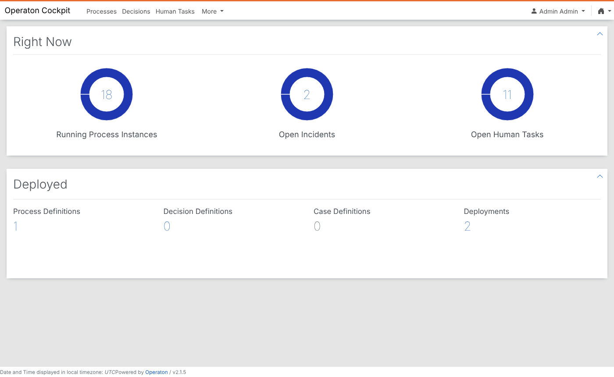
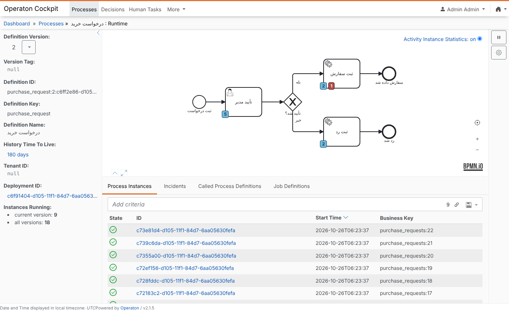
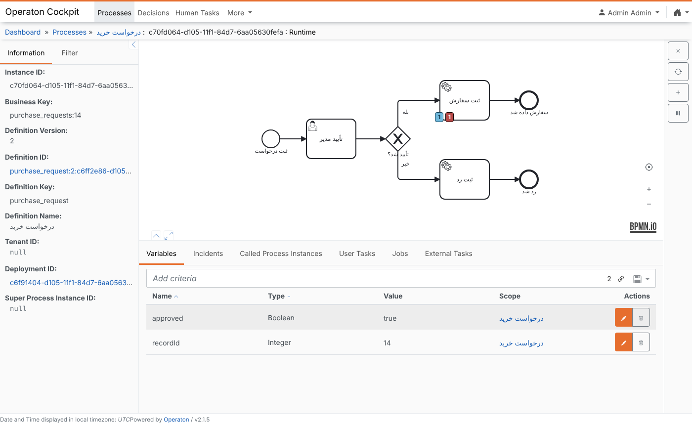
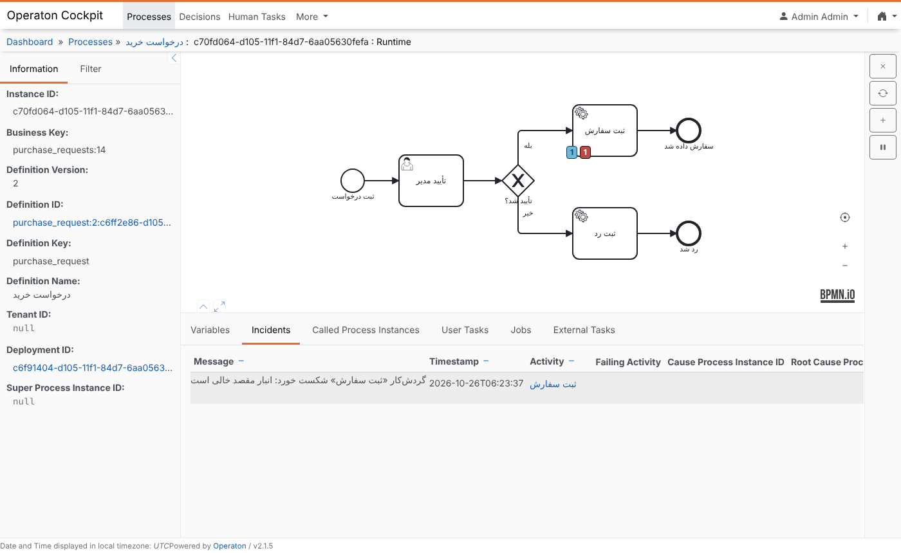

# سکوی فرایند: طراحی، مدیریت و پایش فرایند BPMN داخل NocoBase

> وضعیت: **پیشنهاد برای تأیید صاحب پروژه** (۱۴۰۵/۰۸/۰۴). اپیک این طرح [EPIC-021](../../backlog/epics/EPIC-021-process-platform/epic.md) است.
> ماکاپ صفحه‌ها: [ماکاپ سکوی فرایند](https://claude.ai/artifact/3aWuw9aWzVPFMCX85L9Dwf) (فقط صاحب پروژه می‌تواند بازش کند تا وقتی که آن را هم‌رسانی کند).

## خلاصه

امروز موتور فرایند (Operaton، هم‌خانواده‌ی Camunda 7) به NocoBase وصل است و فرایند نمونه‌ی «درخواست خرید» از ابتدا تا انتها کار می‌کند ([EPIC-016](../../backlog/epics/EPIC-016-bpmn-engine/epic.md) و [گزارش PoC](../research/bpmn-poc.md)). ولی مدل بیرون از برنامه ساخته می‌شود، صفحه‌ای برای دیدن نمونه‌ها نیست و خطاها فقط با REST موتور دیده می‌شوند.

این طرح یک منوی «فرایندها» داخل NocoBase می‌سازد که همه‌چیز در آن فارسی و راست‌به‌چپ است:

1. **طراحی فرایند** با ویرایشگر BPMN داخل برنامه و پنل ویژگی‌هایی که نقش‌ها، فرم‌ها و گردش‌کارهای NocoBase را می‌شناسد.
2. **وصل کردن فرایند به منو**: کارت شروع، دکمه روی جدول، بلوک وضعیت در صفحه‌ی رکورد و صندوق کار واحد.
3. **مدیریت فرایندها**: شمار نمونه‌ها در هر فرایند، اینکه هر نمونه الان کجاست، تاریخچه، و کارهای مدیر (واگذاری، تعلیق، لغو، انتقال به نسخه‌ی تازه).
4. **لاگ و پایش**: لاگ اتصال با شناسه‌ی پیگیری، خطاها با تلاش دوباره، دیرکردها، سلامت موتور و هشدار.

موتور همان Operaton می‌ماند. Cockpit خود موتور فقط برای مدیر فنی است و پشت مسیر محافظت‌شده باز می‌شود.

## آنچه از Bizagi، Axelor و ProcessMaker برمی‌داریم

| ایده | از کجا | در طرح ما |
| --- | --- | --- |
| ویرایشگر BPMN داخل خود برنامه با bpmn-js، پنل ویژگی‌ها، بررسی مدل (bpmnlint) و شبیه‌سازی | Axelor Studio BPM (همان پشته: bpmn-js و موتور Camunda 7) | صفحه‌ی «طراحی فرایند»، دکمه‌های «بررسی مدل» و «اجرای آزمایشی» |
| مرحله‌ی کار انسانی به یک نمای داده‌ی موجود وصل است و فیلدها را در آن مرحله پنهان، الزامی یا فقط‌خواندنی می‌کند | Axelor | فرم کار = فرم NocoBase روی همان مجموعه |
| تنظیم هر کار: فرم، مهلت، نوع واگذاری (گروهی و برداشتن، درخواست‌دهنده، مسئول قبلی، قاعده)، اجازه‌ی واگذاری، اعلان، تشدید به مدیر | ProcessMaker | پنل ویژگی‌های فارسی |
| کاتالوگ شروع فرایند با دسته‌بندی، شرح و دکمه‌ی «شروع» | ProcessMaker Launchpad، Bizagi «مورد تازه» | «شروع فرایند» و کارت‌های «درخواست‌های من» |
| صندوق کار با مهلت، شمارنده‌ی دیرکرد، اولویت، صف گروهی با «برداشتن» و کار گروهی | ProcessMaker | صندوق کار نسخه‌ی ۲ |
| چراغ راهنمایی مهلت: سبز به‌موقع، زرد در خطر، قرمز دیرکرد | Bizagi | برچسب مهلت در صندوق کار و فهرست نمونه‌ها |
| پیگیری درخواست برای درخواست‌دهنده: مرحله‌های طی‌شده سبز، مرحله‌ی فعلی آبی، بقیه خاکستری | ProcessMaker | «درخواست من کجاست» و صفحه‌ی نمونه |
| شمار نمونه و خطا روی هر گره‌ی نمودار | Axelor «BPM State»، Cockpit | صفحه‌ی یک فرایند |
| صفحه‌ی انتقال نمونه‌ها به نسخه‌ی تازه با نگاشت گره‌ها و گزارش شکست | Axelor | «انتقال به نسخه‌ی دیگر» |
| پایش کسب‌وکار: به‌موقع/در خطر/دیرکرد برای هر فرایند و هر مرحله، بار کاری هر نفر | Bizagi BAM، داشبورد Axelor | «پایش و هشدارها» و «زمان هر مرحله» |
| تقویم کاری و تعطیلات که بدون استقرار دوباره عوض می‌شود | Bizagi | تقویم کاری شمسی برای مهلت‌ها |
| کنسول کارهای ناهمگام شکست‌خورده | Bizagi | فهرست خطاها با «تلاش دوباره» |

ProcessMaker با مجوز AGPL است و ویرایشگرش bpmn-js نیست، پس فقط ایده‌ی رابط کاربری را برمی‌داریم. Bizagi ویرایشگر رومیزی دارد، که با هدف «همه‌چیز داخل NocoBase» نمی‌خواند.

## منوی «فرایندها»

یک منوی بالای NocoBase با این بخش‌ها. هر بخش را ACL نقش‌ها نشان می‌دهد یا پنهان می‌کند.

| بخش | برای چه کسی | صفحه در ماکاپ |
| --- | --- | --- |
| صندوق کار من | همه | ۵ |
| شروع فرایند | هر نقشی که اجازه‌ی شروع دارد | ۶ |
| درخواست‌های من | همه | ۶ |
| مدیریت فرایندها | مدیر فرایند | ۲، ۳ و ۴ |
| پایش و هشدارها | مدیر فرایند و مدیر فنی | ۷ |
| طراحی فرایند | طراح فرایند | ۱ |
| گزارش‌های فرایند | مدیر فرایند | (گام بعد) |

این صفحه‌ها صفحه‌های معمولی NocoBase با بلوک‌های تازه‌ی `plugin-bpm` هستند، پس سازنده‌ی صفحه می‌تواند آن‌ها را جابه‌جا کند یا در منوی یک واحد هم بگذارد.

## ۱. طراحی فرایند داخل NocoBase

- **ویرایشگر:** `bpmn-js` (Modeler) با `bpmn-js-properties-panel` و `camunda-bpmn-moddle`، در صفحه‌ی «طراحی فرایند». همان پشته‌ای است که Axelor استفاده می‌کند. خروجی یک فایل BPMN 2.0 استاندارد است و در Camunda Modeler هم باز می‌شود.
- **پنل ویژگی‌های فارسی و آگاه از NocoBase:** به جای جعبه‌های متنی Camunda، فهرست‌های انتخابی از خود NocoBase:
  - مسئول: نقش NocoBase (`candidateGroups`)، کاربر، درخواست‌دهنده، یا مسئول مرحله‌ی قبل.
  - فرم: فرمی از NocoBase روی مجموعه‌ی همان فرایند، با فیلدهای الزامی و فقط‌خواندنی در این مرحله.
  - کار سرویس: یک گردش‌کار NocoBase از نوع «کار سرویس BPMN» (موضوع کار سرویس از آن ساخته می‌شود).
  - مهلت: مدت (مثلاً «۲ روز کاری») روی تقویم کاری شمسی، و کار پس از مهلت (یادآوری، تشدید به مدیر).
  - تصمیم‌ها: دکمه‌های کار انسانی (تأیید، رد، برگشت برای اصلاح) که به متغیر خروجی تبدیل می‌شوند.
  این‌ها با **element template**های Camunda 7 یا یک `PropertiesProvider` سفارشی ساخته می‌شوند تا فایل BPMN استاندارد بماند.
- **ترجمه:** ماژول `translate` در bpmn-js همه‌ی برچسب‌های ویرایشگر و پنل ویژگی‌ها را از یک واژه‌نامه‌ی فارسی می‌گیرد. واژه‌ها از [`glossary/fa-IR.csv`](../../glossary/fa-IR.csv) می‌آیند (فرایند، نمونه‌ی فرایند، کار انسانی، کار سرویس، استقرار، کلید کسب‌وکار).
- **راست‌به‌چپ:** bpmn-js راست‌به‌چپ را نمی‌شناسد. خود بوم چپ‌به‌راست می‌ماند (مختصات BPMN و ابزار رسم به آن وابسته‌اند) و فقط برچسب‌ها (`tspan{direction:rtl;unicode-bidi:embed}`)، پنل ویژگی‌ها و نوار ابزار راست‌به‌چپ می‌شوند. جهت جریان روی نمودار انتخاب طراح است. پیش‌فرض قالب‌های ما راست‌به‌چپ است، مثل ماکاپ. برچسب‌های بلند فارسی در bpmn-js بد شکسته می‌شوند. باید قاعده‌ی شکستن خط را آزمون تصویری کنیم.
- **بررسی و آزمایش:** «بررسی مدل» با `bpmnlint` و چند قاعده‌ی خودمان (هر کار انسانی مسئول و فرم دارد، هر کار سرویس گردش‌کار دارد، هر دروازه مسیر پیش‌فرض دارد). «اجرای آزمایشی» با `bpmn-js-token-simulation`، بدون موتور.
- **پیش‌نویس، استقرار و نسخه:** طراح روی پیش‌نویس کار می‌کند. «استقرار نسخه‌ی تازه» مدل را با `POST /deployment/create` و `deploy-changed-only` به موتور می‌دهد. نمونه‌های باز روی نسخه‌ی خودشان می‌مانند تا مدیر آن‌ها را منتقل کند. هر استقرار با نام کاربر و زمان در لاگ می‌ماند.
- **نمودار همیشه DI دارد:** فایل BPMN بدون بخش نقشه (BPMN DI) در هیچ نمایشگری دیده نمی‌شود. مدل فعلی [`bpmn/purchase-request.bpmn`](../../bpmn/purchase-request.bpmn) DI ندارد و Cockpit برایش «no diagram to display» نشان می‌دهد. ویرایشگر همیشه DI می‌نویسد و مدل نمونه باید دوباره ذخیره شود.
- **فرایند در ماژول ERP:** قالب ماژول ([تصمیم ۰۰۰۵](../decisions/0005-erp-module-format.md)) مدل BPMN را هم با خودش می‌برد. ورود ماژول فرایند را مستقر می‌کند و حذفش نمونه‌های باز را با تأیید کاربر لغو می‌کند (پیشنهاد ۴ PoC).
- **مجوز bpmn-js:** مجوز bpmn.io شبیه MIT است، با یک شرط: نشان bpmn.io روی بوم نباید پاک یا پنهان شود. بقیه‌ی بسته‌ها MIT هستند.

## ۲. وصل کردن فرایند به منوها

هر فرایند مستقرشده را می‌شود بدون کدنویسی به یکی از این جاها وصل کرد:

1. **کارت در «شروع فرایند»** برای نقش‌هایی که اجازه‌ی شروع دارند. شروع یک فرم NocoBase باز می‌کند، رکورد می‌سازد و فرایند را با کلید `<مجموعه>:<شناسه>` شروع می‌کند.
2. **دکمه یا رویداد روی یک مجموعه:** همان نود «شروع فرایند BPMN» که امروز هست، یا یک دکمه‌ی آماده روی جدول.
3. **بلوک «وضعیت فرایند»** در صفحه‌ی جزئیات رکورد: مرحله‌های طی‌شده و فعلی، مسئول فعلی و پیوند به نمودار.
4. **صندوق کار جداگانه** در منوی یک واحد (مثلاً «صندوق کار خرید») که فقط کارهای یک یا چند فرایند را نشان می‌دهد.

## ۳. مدیریت فرایندها و نمونه‌ها

| صفحه | چه نشان می‌دهد | از کجا می‌آید |
| --- | --- | --- |
| مدیریت فرایندها (ماکاپ ۲) | هر فرایند: نسخه‌ی فعال، شمار در جریان، کار باز، خطا، دیرکرد، میانگین زمان، جای در منو | `GET /process-definition/statistics?incidents=true` و جدول `bpmInstances` |
| یک فرایند (ماکاپ ۳) | نمودار با شمار نمونه در هر مرحله (آبی)، دیرکرد (نارنجی) و خطا (قرمز)؛ فهرست نمونه‌ها با مرحله‌ی فعلی و مسئول؛ زمان هر مرحله؛ نسخه‌ها | `GET /process-definition/key/{key}/statistics?incidents=true`، نمایشگر bpmn-js با `overlays` |
| یک نمونه (ماکاپ ۴) | مسیر طی‌شده روی نمودار، تاریخچه با نام و زمان، داده‌ی نمونه، لاگ اتصال، کارهای مدیر | `GET /history/activity-instance`، `GET /process-instance/{id}/activity-instances`، `bpmEvents` |

کارهای مدیر فرایند، هر کدام با ثبت نام، زمان و دلیل:

- واگذاری کار به شخص دیگر (`/task/{id}/assignee`)
- تعلیق و ادامه (`/process-instance/{id}/suspended`)
- لغو با دلیل (`DELETE /process-instance/{id}` با `skipCustomListeners=false`)
- بردن به مرحله‌ی دیگر (`/process-instance/{id}/modification`)
- انتقال به نسخه‌ی دیگر، تکی یا گروهی (`/migration/executeAsync`)

همه‌ی این APIها در نسخه‌ی رایگان موتور هستند. فقط رابط کاربری‌شان در Cockpit رایگان نیست (بخش ۷).

## ۴. صندوق کار و پیگیری درخواست

- **صندوق کار نسخه‌ی ۲:** زبانه‌های «به من»، «گروه من» و «دیرکرد»؛ «برداشتن کار» (claim) برای کار گروهی؛ برچسب مهلت سبز/زرد/قرمز؛ صفحه‌بندی سمت موتور؛ تازه شدن خودکار. این‌ها پرسش‌های باز [STORY-082](../../backlog/epics/EPIC-016-bpmn-engine/STORY-082-task-inbox.md) را می‌بندند.
- **فرم کار = فرم NocoBase:** امروز فرم کار از خود مدل BPMN می‌آید. در طرح تازه، طراح یک فرم NocoBase روی همان مجموعه انتخاب می‌کند. فیلدهای رکورد در همان فرم ویرایش می‌شوند و فقط تصمیم‌ها به موتور می‌روند. مالکیت داده طبق [تصمیم ۰۰۰۷](../decisions/0007-bpmn-engine.md) می‌ماند: داده‌ی کسب‌وکار در NocoBase، تصمیم و کلید در موتور.
- **درخواست من کجاست:** برای درخواست‌دهنده، مرحله‌ها به شکل گام‌نما، با «نزد چه کسی، از کی، تا کی». اگر کار به او برگشته باشد («برگشت برای اصلاح»)، بالای فهرست می‌آید.
- **مهلت و تقویم کاری:** مهلت بر حسب «روز کاری» روی تقویم شمسی با تعطیلات رسمی. تعطیلات از یک مجموعه‌ی NocoBase خوانده می‌شود و بدون استقرار دوباره عوض می‌شود. موتور تاریخ مهلت را UTC نگه می‌دارد. پلاگین آن را هنگام ساخت کار از روی تقویم حساب می‌کند و در `dueDate` کار می‌نویسد.

## ۵. لاگ، ردیابی و منبع حقیقت

**لاگ اتصال `bpmEvents`.** یک مجموعه در NocoBase که هر تبادل با موتور یک ردیف در آن است:

- زمان، جهت (NocoBase ← موتور، موتور ← NocoBase، همگام‌سازی، بازبینی)
- فرایند، کلید کسب‌وکار، شناسه‌ی نمونه
- رویداد (شروع، پیام، انجام کار، برداشتن، واگذاری، کار سرویس، خطا، استقرار، کار مدیر)
- کاربر NocoBase، شناسه‌ی پیگیری، مدت، نتیجه، خلاصه‌ی خطا

شناسه‌ی پیگیری (correlation id) در سربرگ درخواست به موتور، در لاگ سرور NocoBase و در متغیر نمونه (`_traceId`) هم نوشته می‌شود، تا یک رویداد را بشود از دکمه تا موتور دنبال کرد. داده‌ی فرم و رمزها در لاگ نوشته نمی‌شوند. لاگ پس از ۹۰ روز (قابل تنظیم) پاک می‌شود.

**جدول `bpmInstances`.** تصویری از هر نمونه در NocoBase: فرایند، نسخه، کلید، رکورد، درخواست‌دهنده، وضعیت، مرحله‌ی فعلی، مسئول فعلی، مهلت، زمان شروع و پایان. سه راه تازه نگه‌اش می‌دارند:

1. هر کاری که از NocoBase به موتور می‌رود، پس از موفقیت، همین ردیف را به‌روز می‌کند.
2. Worker هر چند ثانیه تغییرهای تازه را از تاریخچه‌ی موتور می‌خواند (`/history/activity-instance?startedAfter=` و `finishedAfter=`).
3. بازبینی شبانه همه‌ی نمونه‌های باز را با موتور مقایسه می‌کند و اختلاف را در لاگ می‌نویسد و درست می‌کند.

منبع حقیقت وضعیت فرایند **همیشه موتور** است. `bpmInstances` فقط برای فهرست، فیلتر، گزارش و ACL است. با آن، «درخواست‌های من» و گزارش‌ها بدون صدها درخواست به موتور کار می‌کنند، و ACL و فیلتر و خروجی اکسل NocoBase رویش کار می‌کند.

**صف ارسال (outbox).** شروع فرایند و فرستادن پیام اول در جدول `bpmOutbox` در همان تراکنش رکورد نوشته می‌شوند. Worker آن‌ها را با تلاش دوباره و فاصله‌ی رو به افزایش می‌فرستد. اگر موتور خاموش باشد، ثبت رکورد خراب نمی‌شود و درخواست بعداً فرستاده می‌شود (پیشنهاد ۱ PoC). کلید کسب‌وکار و جست‌وجوی نمونه‌ی باز، فرستادن دوباره را بی‌خطر می‌کند.

**تاریخچه‌ی موتور.**
- سطح تاریخچه `full`. این سطح برای لاگ کارهای کاربر، خطاها و لاگ کارهای زمان‌بندی‌شده لازم است.
- `historyTimeToLive` برای هر فرایند (پیش‌فرض ۱۸۰ روز). موتور بدون آن مدل را نمی‌پذیرد.
- پنجره‌ی پاک‌سازی شبانه (`historyCleanupBatchWindowStartTime`). بدون پنجره، پاک‌سازی هرگز اجرا نمی‌شود و پایگاه داده فقط بزرگ می‌شود.
- پیش از پاک شدن، خلاصه‌ی هر نمونه در `bpmInstances` می‌ماند. پس گزارش‌های قدیمی از بین نمی‌روند.

**لاگ خود موتور.** گروه‌های `org.operaton.bpm.engine.externaltask`، `.incident` و `.jobexecutor` در سطح INFO، و بقیه در WARN. MDC موتور شناسه‌ی نمونه و کلید کسب‌وکار را دارد. لاگ‌ها در قالب JSON به همان جایی می‌روند که لاگ NocoBase می‌رود.

## ۶. پایش و هشدار

| چه چیزی | چطور | هشدار پیش‌فرض |
| --- | --- | --- |
| سلامت موتور | `/actuator/health` (liveness و readiness) هر ۳۰ ثانیه | ۲ دقیقه بی‌پاسخ: پیامک یا ایمیل به مدیر فنی |
| کارگر کار سرویس | زمان آخرین `fetchAndLock` موفق و شمار کار در صف | بیش از ۵ دقیقه بی‌دریافت |
| صف ارسال | شمار ردیف‌های در انتظار و قدیمی‌ترین | بیش از ۱۰ مورد یا بیش از ۱۰ دقیقه |
| خطاها (incident) | `GET /incident` | خطای تازه: اعلان به مدیر فنی و مدیر فرایند |
| دیرکرد | `bpmInstances.due` و کارهای باز | یادآوری به مسئول؛ پس از ۱ روز به مدیر او |
| همگام‌سازی | نتیجه‌ی بازبینی شبانه | هر اختلاف |
| فضای تاریخچه | حجم schema موتور | رشد غیرعادی |

هشدارها با سامانه‌ی اعلان NocoBase (درون‌برنامه و ایمیل) فرستاده می‌شوند. پیامک به درگاه پیامک بستگی دارد (پرسش باز).

برای نصب‌های بزرگ‌تر، خروجی Prometheus اختیاری است: `micrometer-registry-prometheus` روی Actuator موتور (در ایمیج پیش‌فرض نیست و `/actuator/prometheus` امروز ۴۰۴ می‌دهد) و یک `/metrics` در پلاگین برای صف، دیرکرد و خطا. داشبورد Grafana در گام اول لازم نیست.

## ۷. ابزار خود موتور: Cockpit

موتور یک رابط وب رایگان به نام **Cockpit** دارد (و Tasklist و Admin). برای دیدن گردش فرایند لازم نیست، چون صفحه‌های بالا همین کار را فارسی انجام می‌دهند. ولی برای مدیر فنی ابزار خوبی برای عیب‌یابی است. تصویرها از همین موتور با فرایند نمونه گرفته شده‌اند.

| داشبورد | یک فرایند با شمار نمونه و خطا |
| --- | --- |
|  |  |
| **یک نمونه** | **خطاها** |
|  |  |

Cockpit رایگان (که Operaton هم همان را دارد) این‌ها را **ندارد**؛ این قابلیت‌ها در Camunda 7 فقط در نسخه‌ی پولی هستند:

- تاریخچه‌ی فرایند و نمونه (در Operaton آدرس history به داشبورد برمی‌گردد)
- نقشه‌ی گرمایی گلوگاه‌ها
- رابط انتقال نمونه به نسخه‌ی تازه و رابط بردن نمونه به مرحله‌ی دیگر
- رابط عملیات گروهی (منوی More فقط Deployments و Batches دارد)

APIهای همه‌ی این‌ها در نسخه‌ی رایگان هست و صفحه‌های بخش ۳ از آن‌ها استفاده می‌کنند. اگر مدیر فنی همین‌ها را داخل خود Cockpit هم بخواهد، افزونه‌ی [operaton-cockpit-plugins](https://github.com/datakurre/camunda-cockpit-plugins) (Apache-2.0) تاریخچه، نقشه‌ی گرمایی و جابه‌جایی نمونه را اضافه می‌کند. این اختیاری است.

**دسترسی به Cockpit.** امروز درگاه موتور بیرون نیست و همین‌طور می‌ماند. پیشنهاد: یک مسیر `/bpm-console/` در همان پراکسی NocoBase که فقط به نقش «مدیر فنی» باز است، با کاربر جداگانه‌ی موتور برای هر مدیر فنی، نه کاربر سرویس پلاگین. تا آن وقت، دسترسی فقط با تونل SSH به شبکه‌ی داخلی Docker است.

## ۸. نکته‌های فنی اتصال

بر پایه‌ی مستندات Camunda 7، که Operaton همان API را دارد:

1. **فقط REST، فقط از راه `BpmEngine`.** پلاگین هیچ‌وقت مستقیم به جدول‌های موتور نمی‌زند. پس جایگزینی Operaton با CIB seven یا Camunda 7 Enterprise بدون تغییر پلاگین ممکن است.
2. **کار سرویس با long polling.** `fetchAndLock` با `asyncResponseTimeout` (مثلاً ۲۰ ثانیه) به جای پرسیدن هر چند ثانیه. `lockDuration` دست‌کم برابر زمان کار است و برای کار طولانی `extendLock`.
3. **شکست کار سرویس.** در `handleFailure` شمار تلاش را **خود Worker کم می‌کند**، با `retryTimeout` رو به افزایش. در صفر، موتور خطا (incident) می‌سازد. پیام خطا حداکثر ۶۶۶ نویسه است؛ جزئیات در `errorDetails`. خطای کسب‌وکار («تأمین‌کننده ندارد») با `handleBpmnError` به رویداد مرزی می‌رود.
4. **دست‌کم یک بار.** اگر قفل تمام شود، کار دوباره گرفته می‌شود. پس هر اثر در NocoBase با `externalTaskId` یا `processInstanceId + activityId` یکتا می‌شود (جدول اثرهای انجام‌شده).
5. **کلید کسب‌وکار.** `<collection>:<id>` همان قاعده‌ی امروز. پیام‌ها با `POST /message`، `businessKey` و `resultEnabled=true` همبسته می‌شوند تا «پیام به جایی نرسید» دیده شود.
6. **نقطه‌ی ذخیره.** `asyncBefore` روی کارهای سرویس و `asyncAfter` روی کارهای انسانی، تا شکست یک گام نمونه را به عقب نبرد.
7. **هویت.** کاربران NocoBase در موتور ساخته نمی‌شوند. `candidateGroups` = نام فنی نقش، `assignee` = شناسه‌ی کاربر NocoBase. پرس‌وجوی کارها همیشه با گروه‌های صریح است.
8. **امنیت.** Basic Auth با کاربر سرویس، رمز فقط از متغیر محیطی در استقرار واقعی، موتور فقط در شبکه‌ی داخلی، و TLS اگر موتور روی میزبان دیگری باشد.
9. **ارتقای موتور.** Operaton 2.2 در ۱ آبان ۱۴۰۵ (۲۳ اکتبر ۲۰۲۶) آمده است، بدون تغییر در قرارداد REST و جدول‌ها. 2.1.6 آخرین نسخه‌ی سری 2.1 است. پیشنهاد: پیش از شروع این اپیک به 2.2 برویم. هر نسخه‌ی فرعی حدود شش ماه پشتیبانی می‌شود، پس ارتقا باید عادت منظم باشد، مثل [سیاست نسخه‌ی NocoBase](../decisions/0002-version-policy.md).
10. **چند مستاجر.** فعلاً یک موتور برای یک نصب. اگر روزی یک نصب چند شرکت داشت، `tenantId` موتور به کار می‌آید.

## ۹. موتور: چرا هنوز Operaton

| گزینه | وضعیت امروز | برای ما |
| --- | --- | --- |
| Camunda 7 Community | پایان عمر با آخرین نسخه‌ی 7.24 در ۲۲ مهر ۱۴۰۴. دیگر وصله‌ی امنیتی ندارد. | نه |
| Camunda 7 Enterprise | پشتیبانی تا ۲۰۳۰، پولی | خرید از ایران عملاً ممکن نیست (برداشت ما، نه حکم حقوقی) |
| Camunda 8 Self-Managed | کد زیر Camunda License؛ **محیط عملیاتی نسخه‌ی Enterprise پولی می‌خواهد**. Operate، Tasklist و Optimize هم همین‌طور. سنگین‌تر (Zeebe و ذخیره‌ی جدا). | نه |
| **Operaton** | Apache-2.0، بدون کلید مجوز، API و جدول‌های سازگار با Camunda 7.24، Cockpit و Tasklist دارد. 2.2 آخرین نسخه. | **بله، همان که داریم** |
| CIB seven | Apache-2.0 با پشتیبانی تجاری. نسخه‌ی 3 رابط‌های وب قدیمی را برمی‌دارد. | جایگزین اگر Operaton متوقف شد |

لایه‌ی `BpmEngine` طوری مانده که `Camunda8Adapter` ممکن باشد. ولی با این مجوز، ساختن آن در برنامه نیست.

## ۱۰. نکته‌های غیرفنی

- **نقش‌ها.** چهار نقش تازه:
  - **صاحب فرایند**: مدیر کسب‌وکار که فرایند را تعریف و تأیید می‌کند.
  - **طراح فرایند**: مدل را در NocoBase می‌کشد.
  - **مدیر فرایند**: نمونه‌ها را می‌بیند، واگذار و لغو می‌کند.
  - **مدیر فنی**: موتور، خطاها و Cockpit با اوست.
  در شرکت کوچک یک نفر می‌تواند چند نقش داشته باشد. نقش‌ها همان نقش‌های NocoBase هستند.
- **حاکمیت تغییر.** استقرار نسخه‌ی تازه تأیید صاحب فرایند را می‌خواهد. پیش‌نویس هر وقت ذخیره می‌شود، ولی «استقرار» فقط با تکه‌ی ACL «استقرار فرایند» ممکن است و در لاگ می‌ماند. تغییر فرایند در جریان، کار کاربران را عوض می‌کند و باید به آن‌ها خبر داده شود.
- **چرخه‌ی عمر فرایند:** پیش‌نویس، مستقرشده (فعال)، متوقف (شروع تازه نمی‌پذیرد ولی نمونه‌های باز تمام می‌شوند)، بایگانی.
- **از گردش‌کار تا فرایند.** همه‌چیز BPMN لازم ندارد. قاعده‌ی سرانگشتی: کار یک‌مرحله‌ای یا خودکار درون یک مجموعه، گردش‌کار NocoBase است. چندنفره، چندروزه، با مهلت یا ممیزی، فرایند BPMN است. این را در راهنمای ماژول هم می‌نویسیم.
- **نام‌گذاری و زبان.** نام مرحله‌ها فعل و فارسی («تأیید مدیر مالی»)، کلید فنی انگلیسی (`finance_approval`)، مطابق واژه‌نامه.
- **آموزش.** یک راهنمای یک‌صفحه‌ای برای هر نقش، و فرایند نمونه‌ی «درخواست خرید» به‌عنوان قالب آماده.
- **نگهداری داده.** تاریخچه‌ی موتور ۱۸۰ روز، خلاصه‌ی نمونه‌ها در NocoBase بی‌مهلت، لاگ اتصال ۹۰ روز. اگر قانون یا ممیزی مدت دیگری بخواهد، صاحب پروژه تعیین می‌کند.
- **پشتیبان.** موتور در همان PostgreSQL است، پس پشتیبان فعلی هر دو را دارد. بازگردانی باید هر دو را با هم برگرداند.
- **منابع.** موتور حدود ۶۰۰ مگابایت حافظه می‌خواهد ([گزارش PoC](../research/bpmn-poc.md#هزینهی-منابع)). ویرایشگر و صفحه‌ها فقط در کلاینت بار اضافه دارند. bpmn-js حدود ۱ مگابایت است و فقط در صفحه‌ی طراحی بار می‌شود.
- **شاخص‌های موفقیت.** میانگین زمان هر فرایند، درصد کارهای به‌موقع، شمار خطاهای باز و زمان رفع آن‌ها.

## مرحله‌بندی

| مرحله | خروجی برای کاربر | استوری‌ها |
| --- | --- | --- |
| **۱. پایه‌ی عملیاتی و دیدن** | مدیر فرایند می‌بیند چه نمونه‌هایی کجا هستند و خطاها را رفع می‌کند. هیچ درخواستی در خاموشی موتور گم نمی‌شود. | STORY-091 تا STORY-098 |
| **۲. کار کاربر** | فرایند در منوها، صندوق کار کامل با مهلت شمسی، درخواست من کجاست | STORY-099 تا STORY-101 |
| **۳. طراحی در NocoBase** | طراح فرایند را بدون Camunda Modeler می‌کشد، مستقر می‌کند و نمونه‌ها را به نسخه‌ی تازه می‌برد. ماژول‌ها فرایند می‌برند. | STORY-102 تا STORY-105 |

مرحله‌ی ۱ اول است، چون پایش و لاگ بدون ویرایشگر هم ارزش دارد و ویرایشگر بدون پایش خطرناک است.

## ریسک‌ها

- **راست‌به‌چپ در bpmn-js.** ویرایشگر راست‌به‌چپ ندارد و برچسب‌های بلند فارسی بد شکسته می‌شوند. کاهش: بوم چپ‌به‌راست، فقط برچسب و پنل راست‌به‌چپ، آزمون تصویری.
- **دو منبع حقیقت.** `bpmInstances` ممکن است از موتور عقب بماند. کاهش: موتور منبع حقیقت است، همگام‌سازی پیوسته، بازبینی شبانه و ستون «آخرین همگام‌سازی».
- **حجم تاریخچه.** با سطح `full` و فرایندهای پرتعداد، schema موتور بزرگ می‌شود. کاهش: TTL، پنجره‌ی پاک‌سازی و پایش حجم.
- **پایداری پروژه‌ی Operaton.** پروژه‌ی جامعه‌محور است. کاهش: فقط REST استاندارد، و CIB seven به‌عنوان جایگزین.
- **انتقال نمونه‌ها.** نمونه‌ای که گرهش در نسخه‌ی تازه نیست منتقل نمی‌شود. کاهش: پیش‌نمایش نگاشت و گزارش شکست، مثل Axelor.
- **پیچیدگی برای کاربر بدون‌کد.** BPMN برای کاربر عادی سخت است. کاهش: پنل ساده با فهرست‌های NocoBase، قالب‌های آماده و بررسی مدل.

## پرسش‌های باز

- **«صندوق کار» یا «کارتابل»؟** واژه‌نامه «صندوق کار» دارد. «کارتابل» در نرم‌افزارهای اداری ایران آشناتر است. اگر صاحب پروژه بخواهد، واژه‌نامه عوض می‌شود.
- **جهت نمودار.** پیش‌فرض قالب‌ها راست‌به‌چپ است (شروع در راست). اگر سازمان با نمودارهای چپ‌به‌راست استاندارد BPMN کار می‌کند، پیش‌فرض عوض می‌شود.
- **دسترسی به Cockpit.** مسیر محافظت‌شده در خود برنامه، یا فقط تونل SSH؟ پیش‌فرض: تونل SSH تا مرحله‌ی ۱ تمام شود.
- **پیامک هشدار.** درگاه پیامک هنوز در پروژه نیست. پیش‌فرض: اعلان درون‌برنامه و ایمیل.
- **مدت نگهداری.** ۱۸۰ روز تاریخچه و ۹۰ روز لاگ پیش‌فرض است. آیا قاعده‌ی ممیزی مدت دیگری می‌خواهد؟
- **DMN.** جدول تصمیم (مثلاً «سقف تأیید هر نقش») در Operaton هست. پیش‌فرض: در این اپیک نیست.
